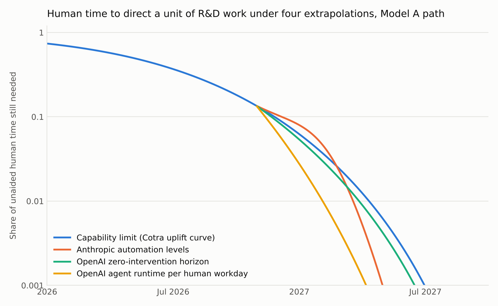
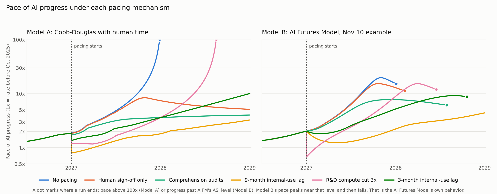
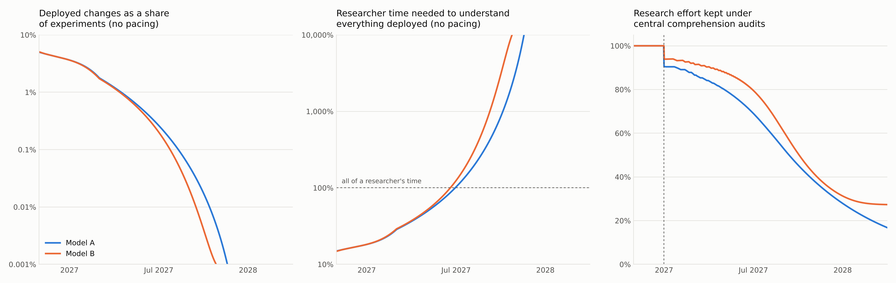
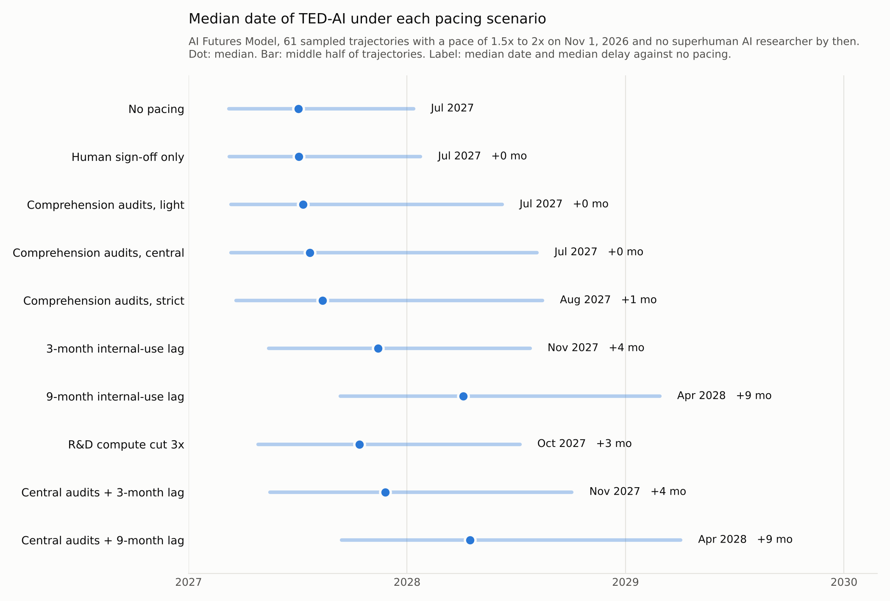
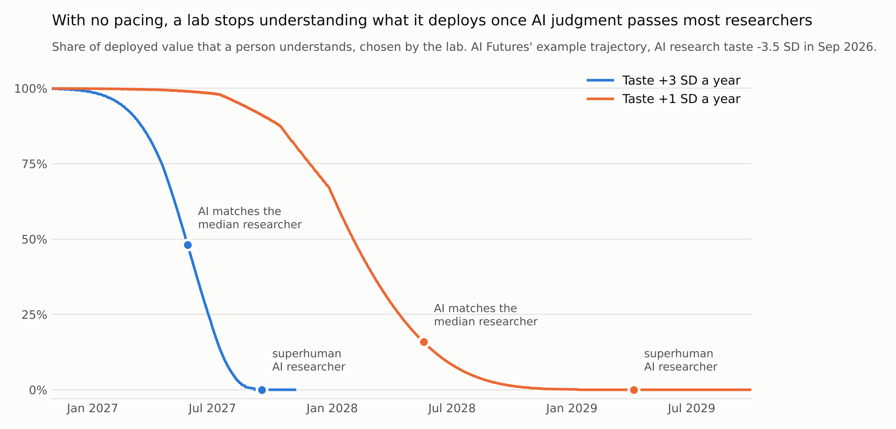
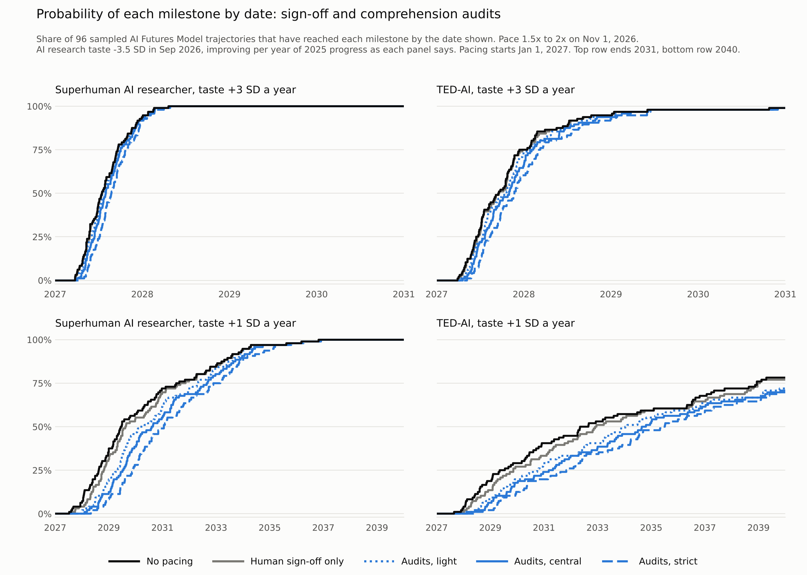
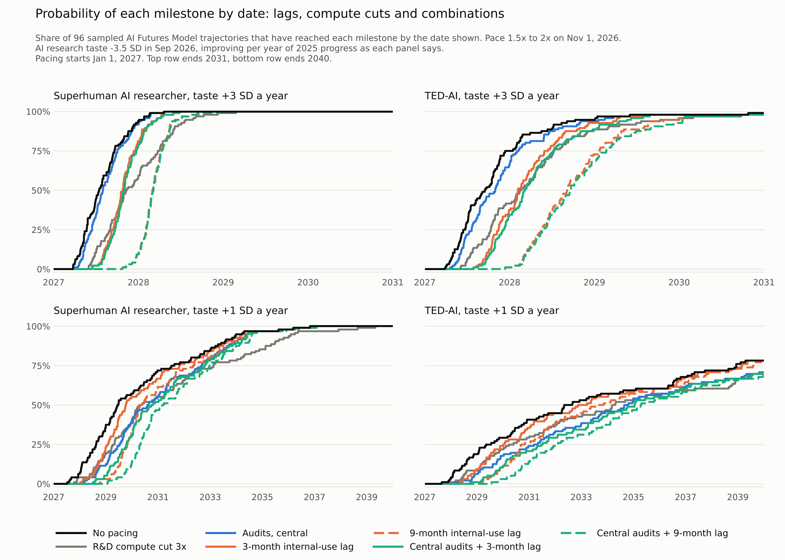
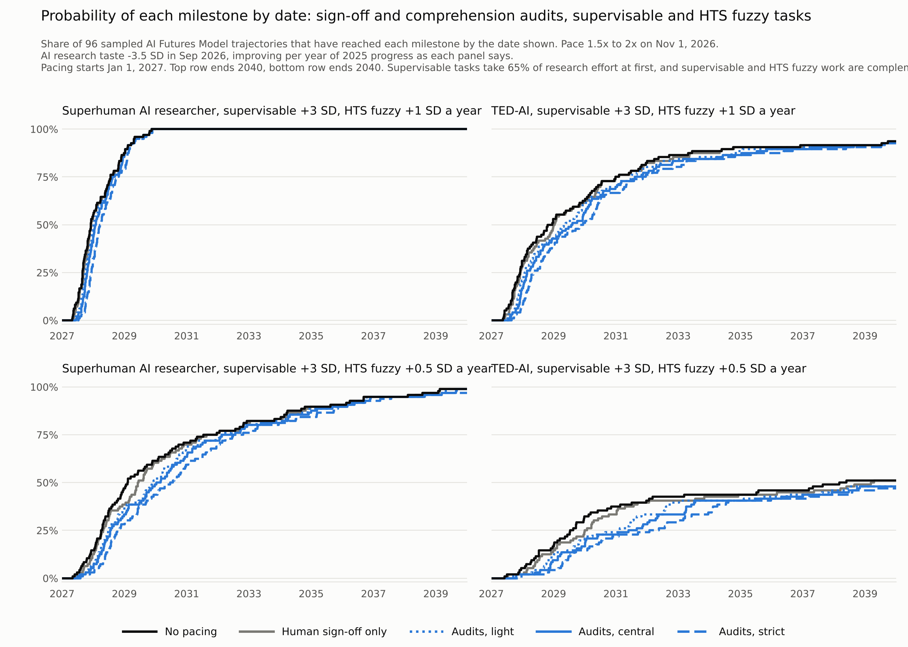
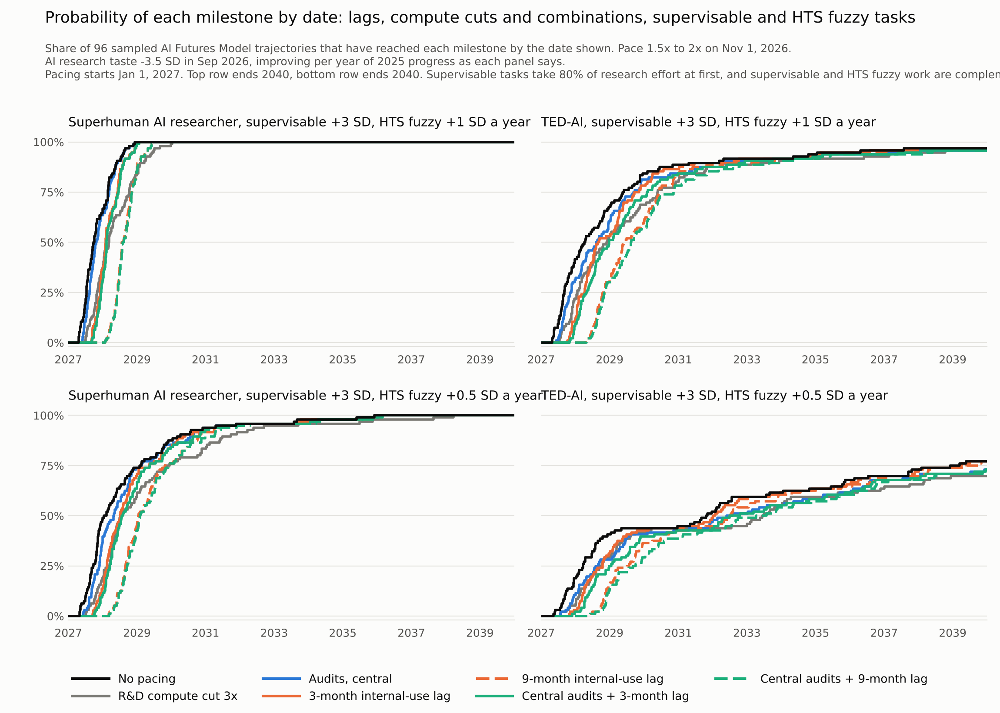

# How pacing mechanisms change the takeoff of automated AI R&D

Research briefing with a runnable model. Draft of 2026-11-11, calibrated to public data as of 2026-11-10. The comprehension gate was rebuilt on 2026-11-10 to count deployed changes by type, and results from the earlier gate are withdrawn. On 2026-11-11 Model B gained a link from comprehension to human research judgment, and the probability of each milestone by date was computed under two taste models. Sections dated 2026-11-11 use the link. Earlier sections do not. On 2026-11-12 research judgment was split into crisp and fuzzy tasks in two further taste models.

## Bottom line

1. **Two published models were turned into simulations and given a human-time input.** Model A is Ajeya Cotra's Cobb-Douglas account (Nov 6). Model B is the AI Futures Project's public code, run on the example trajectory in their Nov 10 update. Both start from an AI-attributable pace of 1.7 times the historical rate on Nov 1, 2026.
2. **With no pacing, both models reach researcher-level AI in mid-2027.** Model A passes ten times the historical pace in September 2027. Model B reaches AI Futures' superintelligence milestone in December 2027.
3. **On the labs' own data, human supervision does not hold the pace back for long.** Anthropic's automation levels give a bottleneck of about a month. OpenAI's data give none, though that result turns on one month of data.
4. **OpenAI's data show supervision thinning faster than autonomy improves.** Agent runtime per researcher doubles every 39 days. The task length agents finish unaided doubles every 72 days.
5. **Deployed changes are a small and shrinking share of experiments, and they still outgrow the people who must understand them.** The model starts from one experiment in twenty ending in a deployed change. With no pacing that share falls to about 0.25% by July 2027. The count per researcher still rises sixfold, and understanding all of it goes from 15% of a researcher's time today to all of it in June 2027, about when researcher-level AI arrives.
6. **Comprehension audits do not move the date of researcher-level AI, and across sampled trajectories they barely move the date of TED-AI either.** On single trajectories they slow what follows: in Model A the pace holds at 3 to 4 times instead of passing 100 times, and on AI Futures' example trajectory the superintelligence milestone moves from December 2027 to June 2028. Across 61 trajectories sampled from AI Futures' own parameter distribution, the median delay to TED-AI is zero months under central audits and one month under strict audits. One trajectory in seven is delayed by six months or more.
7. **Sign-off without a comprehension standard does little.** At half an hour per change it starts to cost the lab in September 2027, against January to April 2027 for comprehension audits, and it moves Model B's superintelligence milestone by one month. The earlier draft's claim that sign-off does most of the pacing is withdrawn.
8. **The cost to the lab is small at first and large within a year.** Under central audits the lab keeps 90% to 94% of its research effort at the start, 69% to 80% in July 2027 and about 30% in January 2028. Researchers spend half to two thirds of their time on comprehension by mid-2027.
9. **Whether audits hold the pace down depends on two numbers nobody has measured.** One is how fast the count of deployed changes grows with AI labor. In Model A, growth faster than about the fourth root of AI labor is enough. The other is how concentrated value is in the best changes. In 4 of 23 one-at-a-time variations the audited run still passes ten times the historical pace during 2028.
10. **An internal-use lag delays TED-AI by about its own length.** Across the sampled trajectories a 3-month lag delays the median TED-AI date by 4 months and a 9-month lag by 9. A 3-fold compute cut delays it by 3 months, and by nothing if it is scoped to one class of work and substituted at the rate OpenAI observed. Audits plus the 9-month lag delay it by 9 months.
11. **The timeline effect of audits is concentrated in slower worlds.** Where TED-AI would arrive before July 2027 with no pacing, central audits delay it by days. Where it would arrive after June 2028, they delay it by 5 months. The gate binds only once deployed changes outgrow what people can understand, and the fast trajectories get to TED-AI first.
12. **What audits do to the timeline turns on AI research judgment, which is the least-evidenced part of the AI Futures Model.** On AI Futures' example trajectory, lowering AI research judgment by 1.5 to 3 standard deviations raises the delay from central audits from 2 months to 4 to 7. Halving the rate at which it improves raises the delay to 20 months. A 3-month lag stays near 7 months throughout. A slower real pace changes the audit delay little, and data-driven progress raises it by half or more.
13. **Tying people's judgment to what they understand barely moves any date.** Added 2026-11-11: in Model B researchers now apply judgment only to deployed changes they understand, and the lab chooses how much to understand. An unpaced lab keeps its understanding while AI judgment is far below its people's and drops it once AI judgment nears the median researcher. Across sampled trajectories this moves the no-pacing dates by a median of 1 to 17 days.
14. **How fast AI research judgment improves decides whether audits are a timeline tool.** Both cases start from AI Futures' base case of -3.5 SD in September 2026. If judgment improves 3 SD per year of 2025 progress, central audits delay researcher-level AI by a median of 0 months and TED-AI by 1. If it improves 1 SD, they delay researcher-level AI by 8 months and TED-AI by 14, and strict audits delay them by 13 and 21. A 3-month lag delays both by 3 to 5 months in either case.
15. **In the slow case audits move the odds by tens of points.** The chance of researcher-level AI before 2029 falls from 36% with no pacing to 12% under central audits, and the chance of TED-AI before 2031 from 41% to 24%. In the fast case the chance of TED-AI before 2028 falls from 75% to 66% under central audits and to 38% under a 3-month lag.
16. **Audits cost a lab that already understands its work almost nothing at the start.** Researchers are taken to spend 14% of their time understanding deployed changes today, with that time already inside measured uplift. Central audits then cost 0.6% of research effort on the first day, against the 6% to 10% in item 8.
17. **A dating error on explosive sampled trajectories was fixed on 2026-11-11.** Medians in items 6, 10 and 11 moved by up to two months. No conclusion changed. The Monte Carlo section describes the error.
18. **Research judgment was split into crisp and fuzzy tasks.** Added 2026-11-12: AI judgment improves 3 SD per year of 2025 progress on crisp tasks, where success is fast and cheap to verify, and 1 SD or 0.5 SD on fuzzy tasks. Crisp work is taken as 70% of research effort today and the two classes as complements. On the example trajectory the share of effort on fuzzy tasks rises from 30% to 60% by January 2028, and to 92% a year later where fuzzy judgment improves at 0.5 SD.
19. **At those inputs the split sits closer to the fast case.** With no pacing the median date of researcher-level AI is October 2027 or January 2028 and of TED-AI May 2028 or May 2031. Central audits delay TED-AI by a median of 2 or 5 months, and a 3-month lag by 5 or 4.
20. **Two unmeasured inputs decide what the split does.** With crisp work at 85% of effort, or with crisp work standing in for fuzzy work more readily, the split behaves like the fast case. With crisp work at 50% and fuzzy judgment improving 0.5 SD a year, TED-AI on the example trajectory moves to August 2034 and the audit delay to 60 months.

## Notes on the sources

- Cotra's post is dated Nov 6. It contains a back-of-envelope calculation and a doubling heuristic, with no simulation. Model A is a dynamic version written for this briefing. The derivation she links was not accessible.
- AI Futures published its update on Nov 10. Its public code is the Sep 9 release. Model B runs that code on the parameter set of the example trajectory in the update. The public code reproduces the first part of that example and runs slower afterwards. See "How the AI Futures update compares".
- The extrapolation of automation levels is AI Futures' logistic fit to Anthropic's Automation Index. Anthropic's page states only the February and August values. The monthly values were read off Anthropic's chart by AI Futures.
- AI Futures states taste slopes per year of 2025 progress. Its public code applies the slope per year of progress at the rate of its mid-2026 anchor date, which is 1.37 times the 2025 rate on the example trajectory. A slope entered as 2.1 is then 1.5 SD per year of 2025 progress. The taste models in this briefing set the slope per year of 2025 progress, as the update's text describes it.
- OpenAI's report was read from a saved copy of the page. Text figures are quoted directly. Chart figures were read from the published charts: two by eye from images, to about two points, and four from the vector lines in a saved PDF. `data/` holds every value with its provenance.

## The two base models

Both models share one loop: better AI raises research effort, research effort improves software, better software means better AI. Progress is measured in baseline-years. One baseline-year is a year of progress at the rate before October 2025 (about 15 points on Anthropic's capability index). Pace is baseline-years per calendar year.

### Model A: Cotra's Cobb-Douglas account

Cotra's argument: capabilities are compute multipliers times training compute, and compute multipliers come from researcher labor and experiment compute in equal shares. Doubling the overall pace then needs a labor speedup of roughly 4 to 9 times at first, and about 10 times after several months of faster progress. As a model:

```
research effort     RE = RE_baseline(t) * labor_uplift^0.5 * compute_multiple^0.5
research stock      dRS/dt = RE
software pace       (RE / RS) / g          g = ln 2 per year, so the no-AI path has pace 1
overall pace        2/3 * software pace + 1/3 * training-compute pace
labor uplift        1 + u0 * 2^(Y / D)     Y = cumulative progress in baseline-years
```

The research stock gives diminishing returns: each doubling of cumulative research buys the same amount of software progress. The two free parameters `u0` and `D` are solved so the model has a pace of 1.2 on May 1, 2026 and 1.7 on Nov 1, 2026.

Calibration result: excess labor uplift doubles every 0.26 baseline-years, and labor uplift on Nov 1, 2026 is 7.4 times. Anthropic staff self-report 12 times and Cotra estimates about 10. The model's uplift is about half the self-reports at each 2026 date. Self-reports match if the labor exponent is about 0.4.

The loop compounds when research effort more than doubles per doubling of the research stock. Here that ratio is 1.30, above the threshold of 1. Model A with no pacing accelerates without limit. That is Cotra's "naive extrapolation".

### Model B: the AI Futures Model

`aifm_adapter.py` imports the AI Futures Project's code (MIT license, commit `1c40ecd`). It does not reimplement it. The AI Futures Model differs from Model A in three ways that matter here:

- Experiment compute and coding labor are complements, so unlimited coding labor raises experiment throughput by a bounded factor.
- AI research judgment is a separate input. It raises the value of each experiment and is what drives the model past human level.
- Humans and AI split coding tasks by an automation schedule, so a human bottleneck on unautomated tasks is already in the model until its "automated coder" milestone.

The adapter lets the model calibrate itself, then integrates forward again from Nov 1, 2026 with the same component functions plus the additions below. With no additions it reproduces the model's own milestone dates to within a week (a test checks this).

The base case is the example trajectory in AI Futures' Nov 10 update: Eli Lifland's August 2026 parameters, with coding uplift of 7.05 times in August 2026 doubling every 3.0 months, coding labor substitutability -0.5, coding labor ceiling 60, and slowdown from 10 times less experiment compute 1.5. On the public code this gives a pace of 1.25 on May 1 and 1.72 on Nov 1, 2026.

Milestones in Model B are AI Futures' own: SAR (superhuman AI researcher), TED-AI (AI that can automate all white-collar work) and ASI (superintelligence). Model A has no such milestones. It reports the date its capability curve reaches a labor uplift of 1,000 times, which is AI Futures' rough figure for SAR.

## Modification 1: human time stays an input

Labor uplift is output per human hour. Its reciprocal is the human time needed to direct each unit of work, as a share of doing it unaided. On Nov 1, 2026 Model A puts that at 0.135. The base models assume it keeps falling as fast as capability allows. The modification asks what the labs' own data say about how fast it falls. The realized human time is the larger of the capability limit and a supervision schedule.

**Fit to Anthropic's automation levels.** Anthropic reports the share of R&D work at each automation level. Work where AI "leads" (level 4: a human gives a high-level ask, supervises and approves) rose from about 1% in March 2026 to 26% in August. No work was fully autonomous (level 5). The fit is a logistic in capability with a fixed human time per level: 0.50 for level 2 and below, 0.12 for level 3, 0.04 for level 4 and zero for level 5. Those four coefficients are assumptions. Level 5 is assumed to trail level 4 by 7 months, which is AI Futures' assumption, made "based on little data".

Because the fit is indexed to capability and the pace is rising, level 5 arrives sooner in calendar time than in AI Futures' calendar extrapolation: half of work by February 2027 and 95% by April 2027, against their June and November 2027.

**Fits to OpenAI's data.** OpenAI's September report gives two measures.

*What agents can do without help.* OpenAI reports, by month and by task length, the share of researcher tasks that succeed with zero human interventions. In July that share was 87% for tasks under 15 minutes and about half for tasks of 4 to 8 hours. A logistic fit across all months and task lengths puts the task length finished half the time with zero interventions at 1.1 hours in January and 6.3 hours in July. That is a doubling every 2.4 months. Other cuts of the data give 2.1 to 3.6 months. January is a low outlier, and dropping it gives 3.6. The fit assumes human time per unit of work halves each time this horizon doubles: a person hands off one task at a time, and the task gets bigger. In capability units the horizon doubles every 0.24 baseline-years, and capability-limited uplift doubles every 0.26. The two are within noise of each other, so this fit does not bind.

*What supervision is practiced.* Agent workdays per human workday rose from 0.5 in early May 2026 to 3.15 in mid-August, a doubling every 39 days. The chart's date axis was not recoverable. The dates assume daily points ending in mid-August, which puts the crossing of 1.0 on June 11 and agrees with OpenAI's text. Median inference spend per researcher rose from about $1.40 a day in early January to about $600 in mid-August, a doubling every 25 days. This fit does not bind either.

Taken together: agent runtime per researcher is doubling 1.8 times as fast as the task length agents can finish unaided. Across January to July, 51% of successful 4-to-8-hour tasks and 72% of successful 16-to-32-hour tasks needed at least one intervention, and expected interventions grow with roughly the square root of task length. Human attention per unit of agent work is falling faster than the need for it.



The figure evaluates each extrapolation along the same no-pacing path. Realized human time is the larger of the capability limit and the schedule in use. The Anthropic schedule sits above the limit for a few months. Both OpenAI schedules sit at or below it.

## Modification 2: a gate on deployed changes

### What is counted

The gate applies to changes that are deployed to production. Experiments are never gated. An experiment that fails, or succeeds and is not adopted, needs no human understanding.

| | Deployed per researcher-year today | Hours to understand one | Growth with AI labor | Share of progress |
|---|---|---|---|---|
| Training improvements | 6 | 10 | elasticity 0.5 | 0.5 |
| Dataset updates | 8 | 8 | elasticity 0.5 | 0.3 |
| System software changes | 30 | 5 | elasticity 0.3 | 0.2 |
| Monitor changes | 2 | 12 | log of promoted training improvements | required, carries no progress |

Every number in the table is an assumption. Three properties follow from them.

- **Experiments grow in proportion to AI labor.** Automated researchers explore many options.
- **Deployed changes grow more slowly than experiments.** An elasticity of 0.5 means the count grows with the square root of AI labor. One experiment in twenty ends in a deployed change today. The share falls from there because experiments grow faster.
- **More exploration raises the value of each deployed change.** The value of a deployed change is Pareto-distributed with tail index 1.8. Deploying fewer changes from a larger pool of experiments keeps more value per change.

Today's load: understanding everything deployed takes 6 x 10 + 8 x 8 + 30 x 5 + 2 x 12 = 298 hours, 15% of a researcher-year.

### How the deployed share changes with no pacing

| | Nov 2026 | Jan 2027 | Apr 2027 | Jul 2027 |
|---|---|---|---|---|
| AI labor multiple, Model A | 7x | 12x | 70x | 867x |
| Deployed changes per researcher-year | 47 | 55 | 106 | 284 |
| Deployed share of experiments | 4.9% | 3.6% | 1.2% | 0.26% |
| Researcher time to understand everything deployed | 15% | 18% | 36% | 102% |

The share of experiments that is deployed falls by a factor of 19 in eight months. The count of deployed changes per researcher still rises sixfold, because AI labor rises by more than a hundredfold. Model B gives the same picture: 124% of researcher time in July 2027. In both models, understanding everything deployed stops being possible in June 2027 if nothing else changes.

### What the gate does

The gate requires human time on every deployed change: the hours in the table for comprehension audits, half of them for the light variant, twice for strict, and half an hour per change for sign-off with no comprehension standard.

The lab responds by choosing how much AI labor to use, and so how many experiments to run, and how to split each researcher's year between directing that labor and understanding what is deployed. When people cannot understand everything the lab would deploy, it deploys the most valuable fraction of each type. Hours go first to the monitor changes that the promoted training improvements require, then across types to keep the most value. The best fraction `q` of a type holds `q^(1 - 1/1.8)` of that type's value.

The audit process itself (about 150 lab staff hours for 22 audits a quarter, from the paper's Section 8.4) is not modeled as a cost. The audit is the mechanism that makes the hours real.

### What decides whether the gate holds the pace down

Once the gate binds in Model A, research effort grows with AI labor to the power 0.30 instead of 0.50. The loop ratio falls from 1.30 to 0.77, below the compounding threshold. The reduction is the tail exponent (0.44) times the progress-weighted elasticity of deployed changes (0.46). The loop stays below the threshold as long as that elasticity is above about 0.26: deployed changes must grow at least as fast as the fourth root of AI labor. Below that, the lab can keep nearly all the value from a count of changes that people can keep up with, and the acceleration continues.

Model B has a second route. Better research judgment raises the value of each experiment without raising the number of deployed changes, so the gate does not touch it. Model B's pace keeps rising under the gate, more slowly.

## Other mechanisms

From AI Futures' "How to pace the US frontier" (Aug 5):

- **Internal-use lag.** Models may be used for AI R&D only 9 months after they exist. A 3-month lag is run for comparison. It is not an AI Futures figure.
- **R&D compute cut.** Experiment and training compute are cut by a constant factor of 3 (for example, a 70% minimum share for external inference). In Model B the compute that runs AI researchers is cut as well. A freeze at the start-date level is also run.

**Evidence on compute controls from OpenAI.** On August 7, OpenAI put model-specific security restrictions on its Astra model. Astra-class GPU allocation fell 59.2% in the following week. Allocation to other model classes rose 17.2%, which offset about 85% of the decline, and total allocation in the analyzed workloads was largely unchanged. OpenAI's own reading: "compute remains valuable and flexible, and will naturally be channeled into alternative uses within the research enterprise." The compute cut modeled here assumes a cap on all R&D compute that cannot be routed around. One extra row shows the same cut scoped the way OpenAI's restriction was, with 85% substituted and the substituted compute assumed to advance the frontier equally. That is the worst case for leakage.

Dario Amodei's capability checkpoints are not modeled. The primary essay was not accessible, and its parameters are not guessed here.

All mechanisms start on Jan 1, 2027.

## Results



### Model A, supervision fitted to Anthropic automation levels

| Mechanism | SAR-level capability | Delay | Pace mid-2027 | Pace Jan 2028 | Pace Jan 2029 | Pace reaches 10x |
|---|---|---|---|---|---|---|
| No pacing | Jul 2027 | +0 mo | 4.8x | 147x | off scale | Sep 2027 |
| Human sign-off, no comprehension standard | Jul 2027 | +0 mo | 4.6x | 7.4x | 5.1x | not by 2032 |
| Comprehension audits, light | Jul 2027 | +1 mo | 3.8x | 4.3x | 4.3x | not by 2032 |
| Comprehension audits, central | Aug 2027 | +1 mo | 3.2x | 3.6x | 4.0x | not by 2032 |
| Comprehension audits, strict | Sep 2027 | +2 mo | 2.6x | 3.0x | 3.7x | not by 2032 |
| Internal-use lag, 3 months | Oct 2027 | +3 mo | 2.3x | 3.6x | 10.0x | Dec 2028 |
| Internal-use lag, 9 months | Feb 2028 | +7 mo | 1.3x | 1.8x | 3.3x | Jun 2031 |
| R&D compute cut 3x | Jan 2028 | +6 mo | 1.7x | 3.6x | off scale | May 2028 |
| R&D compute frozen | Sep 2027 | +3 mo | 2.4x | 4.0x | off scale | Jun 2028 |
| R&D compute cut 3x, scoped and substituted | Jul 2027 | +0 mo | 4.3x | 40.1x | off scale | Oct 2027 |
| Comprehension audits (central) + 3-month lag | Nov 2027 | +4 mo | 2.1x | 2.7x | 3.3x | not by 2032 |
| Comprehension audits (central) + 9-month lag | Feb 2028 | +8 mo | 1.3x | 1.7x | 2.5x | not by 2032 |

### Model B, AI Futures' Nov 10 example, supervision fitted to Anthropic automation levels

| Mechanism | SAR | Delay | TED-AI | ASI | ASI delay | Pace mid-2027 | Pace Jan 2028 | Pace reaches 10x |
|---|---|---|---|---|---|---|---|---|
| No pacing | Jun 2027 | +0 mo | Oct 2027 | Dec 2027 | +0 mo | 6.5x | 15.4x | Aug 2027 |
| Human sign-off, no comprehension standard | Jun 2027 | +0 mo | Oct 2027 | Jan 2028 | +1 mo | 6.3x | 12.9x | Aug 2027 |
| Comprehension audits, light | Jun 2027 | +0 mo | Nov 2027 | Apr 2028 | +4 mo | 5.7x | 9.3x | not by 2032 |
| Comprehension audits, central | Jun 2027 | +0 mo | Dec 2027 | Jun 2028 | +6 mo | 5.0x | 7.8x | not by 2032 |
| Comprehension audits, strict | Jul 2027 | +1 mo | Jan 2028 | Sep 2028 | +9 mo | 4.1x | 6.2x | not by 2032 |
| Internal-use lag, 3 months | Sep 2027 | +2 mo | Apr 2028 | Sep 2028 | +9 mo | 2.6x | 5.2x | not by 2032 |
| Internal-use lag, 9 months | Dec 2027 | +6 mo | Dec 2028 | Sep 2029 | +21 mo | 1.3x | 2.2x | not by 2032 |
| R&D compute cut 3x | Sep 2027 | +3 mo | Feb 2028 | May 2028 | +5 mo | 2.4x | 8.9x | Jan 2028 |
| R&D compute frozen | Jul 2027 | +1 mo | Dec 2027 | Mar 2028 | +3 mo | 4.1x | 13.2x | Nov 2027 |
| R&D compute cut 3x, scoped and substituted | Jun 2027 | +0 mo | Oct 2027 | Jan 2028 | +0 mo | 5.8x | 16.1x | Aug 2027 |
| Comprehension audits (central) + 3-month lag | Sep 2027 | +3 mo | May 2028 | Feb 2029 | +14 mo | 2.4x | 4.3x | not by 2032 |
| Comprehension audits (central) + 9-month lag | Jan 2028 | +7 mo | Jan 2029 | Feb 2030 | +26 mo | 1.3x | 2.1x | not by 2032 |

"Off scale" means the run had ended: pace above 300 times (Model A) or progress an order of magnitude past the ASI level (Model B). The other supervision fits change these rows by a month at most. With the AI Futures Model as published in August 2026, no pacing gives SAR in August 2028 and ASI in November 2029, and central audits move ASI to November 2030. All rows are in `results/tables.md`.

**Why Model B's pace peaks and then falls.** This is the AI Futures Model's own output, with no pacing and none of this briefing's additions. On the Nov 10 example its pace peaks at 19 times the historical rate in late 2027, within weeks of its superintelligence milestone, and is 4.9 times a year later. Every parameter set tried shows the same shape: a peak of 24 and 29 times with the research-judgment ceiling doubled and quadrupled, and of 3 to 4 times with the August 2026 medians.

The cause is how a research-stock model works. Pace follows the growth rate of research effort, and research effort grows fastest while coding is being automated and AI research judgment is moving through and past the human range. After that, experiments are limited by compute, the model caps the coding labor multiplier at 100 million, and each further step in research judgment adds less as it nears the ceiling the model assumes. Research effort keeps rising and its growth rate falls, so the pace falls. Capability levels do not fall: the model's AI software R&D uplift rises from 43 times in mid-2027 to 5,400 times in January 2028 and 61,500 times in January 2029.

Two consequences for reading the tables. For Model B, compare milestone dates and not the pace in January 2028: by then the no-pacing run is past its peak and the paced runs are not. And Model B's pacing delays are delays to milestones that all sit before the peak.

### Inside the gate



| Model | Mechanism | Date | AI labor used | Deployed changes per researcher-year | Share of experiments deployed | Researcher time on comprehension | Research effort kept |
|---|---|---|---|---|---|---|---|
| A | No pacing | Jul 2027 | 867x | 284 | 0.26% | 102% if all were understood | 100% |
| A | No pacing | Jan 2028 | off scale | off scale | 0.00% | off scale if all were understood | 100% |
| A | Human sign-off, no comprehension standard | Jul 2027 | 718x | 263 | 0.29% | 7% | 96% |
| A | Human sign-off, no comprehension standard | Jan 2028 | 4,471,059x | 2,411 | 0.00% | 60% | 31% |
| A | Comprehension audits, central | Jul 2027 | 200x | 130 | 0.52% | 49% | 69% |
| A | Comprehension audits, central | Jan 2028 | 15,718x | 153 | 0.01% | 61% | 28% |
| A | Comprehension audits, strict | Jul 2027 | 104x | 73 | 0.57% | 58% | 57% |
| A | Comprehension audits, strict | Jan 2028 | 4,093x | 76 | 0.01% | 61% | 27% |
| B | No pacing | Jul 2027 | 3,250x | 340 | 0.20% | 124% if all were understood | 100% |
| B | No pacing | Jan 2028 | off scale | 36,462 | 0.00% | 155 researcher-years if all were understood | 100% |
| B | Human sign-off, no comprehension standard | Jul 2027 | 2,819x | 321 | 0.22% | 8% | 98% |
| B | Human sign-off, no comprehension standard | Jan 2028 | 928,861x | 3,963 | 0.01% | 99% | 68% |
| B | Comprehension audits, central | Jul 2027 | 695x | 183 | 0.51% | 65% | 80% |
| B | Comprehension audits, central | Jan 2028 | 3,946x | 254 | 0.12% | 100% | 31% |
| B | Comprehension audits, strict | Jul 2027 | 309x | 102 | 0.64% | 77% | 67% |
| B | Comprehension audits, strict | Jan 2028 | 2,313x | 124 | 0.10% | 100% | 28% |

"AI labor used" is what the lab chooses to run. Under central audits in July 2027 the lab in Model A uses 200 times the unaided human rate, against 867 on the no-pacing path, and deploys 130 changes per researcher-year against 284.

## Median time to TED-AI across sampled trajectories

The tables above follow one trajectory per model. AI Futures forecasts with a distribution over the model's parameters and keeps the sampled trajectories whose pace on Nov 1, 2026 matches METR. `montecarlo_b.py` does the same on their public code with their sampler and their August 2026 distribution for Daniel Kokotajlo, then runs each kept trajectory under every scenario.

- 4,000 parameter sets were drawn. 79 (2.1%) had a pace of 1.5 to 2 times on Nov 1, 2026. Their median pace is 1.68 times.
- With no pacing those 79 give a median SAR date of January 2027 and a median TED-AI date of May 2027. AI Futures reports February 2027 and July 2027 for its own filtered trajectories, so the method lands within one to two months of theirs.
- 18 of the 79 already have a superhuman AI researcher on Nov 1, 2026, and 4 already have TED-AI. Anthropic and METR both say that is not the case. The figure and table below use the other 61.
- Corrected 2026-11-11. The first version of this section read each milestone's progress level off the AI Futures Model's own trajectory. On explosive trajectories that level came out far too high, so three trajectories recorded no TED-AI with no pacing and others reached it months late. Levels now follow from the model's parameters. Median dates moved one to two months earlier and no conclusion changed.



| Scenario | Median TED-AI | Middle half of trajectories | Median delay | Delay, upper quartile | Median SAR | Median ASI |
|---|---|---|---|---|---|---|
| No pacing | Jul 2027 | Mar 2027 to Jan 2028 | +0 mo | +0 mo | Mar 2027 | Sep 2027 |
| Human sign-off, no comprehension standard | Jul 2027 | Mar 2027 to Jan 2028 | +0 mo | +0 mo | Mar 2027 | Sep 2027 |
| Comprehension audits, light | Jul 2027 | Mar 2027 to Jun 2028 | +0 mo | +1 mo | Mar 2027 | Sep 2027 |
| Comprehension audits, central | Jul 2027 | Mar 2027 to Aug 2028 | +0 mo | +2 mo | Mar 2027 | Oct 2027 |
| Comprehension audits, strict | Aug 2027 | Mar 2027 to Aug 2028 | +1 mo | +3 mo | Mar 2027 | Nov 2027 |
| Internal-use lag, 3 months | Nov 2027 | May 2027 to Jul 2028 | +4 mo | +5 mo | Apr 2027 | Apr 2028 |
| Internal-use lag, 9 months | Apr 2028 | Sep 2027 to Feb 2029 | +9 mo | +13 mo | Jul 2027 | Jan 2029 |
| R&D compute cut 3x | Oct 2027 | Apr 2027 to Jul 2028 | +3 mo | +7 mo | May 2027 | Jan 2028 |
| Comprehension audits (central) + 3-month lag | Nov 2027 | May 2027 to Oct 2028 | +4 mo | +8 mo | Apr 2027 | Apr 2028 |
| Comprehension audits (central) + 9-month lag | Apr 2028 | Sep 2027 to Apr 2029 | +9 mo | +16 mo | Jul 2027 | Feb 2029 |

Delays are paired: each trajectory under a scenario against the same trajectory with no pacing. A milestone not reached by the end of 2035 counts as later than that. The same table for all 79 trajectories is in `results/tables_montecarlo.md`. Its medians are two months earlier and its delays up to two months shorter.

How the audit delay varies with the speed of the trajectory (central audits, 61 trajectories):

| TED-AI date with no pacing | Trajectories | Median delay from central audits |
|---|---|---|
| Before July 2027 | 30 | under 1 month |
| July 2027 to June 2028 | 19 | 1 month |
| After June 2028 | 12 | 5 months |

Central audits delay TED-AI by at least one month in 34% of trajectories and by at least six months in 15%. A 3-month lag delays it by at least one month in 85% and a 9-month lag by at least six months in 75%.

Two reasons the audit delay is small at the median. First, the fast half of the trajectories reaches TED-AI within seven months of the start date, before deployed changes have outgrown what people can understand. Second, in the AI Futures Model progress after coding is automated comes from better research judgment, and the lab can cut its use of AI labor at little cost because experiments are limited by compute. A gate priced per deployed change, at hours that do not rise with the sophistication of the change, has little to grip.

## Three disputed inputs and what they do to the audit result

### How good the evidence is

**AI research judgment.** The AI Futures Model treats research judgment ("research taste") as one number, measured in standard deviations of the human researcher distribution, that rises in a straight line with a capability index. A superhuman AI researcher arrives when it reaches the 99.9th percentile, +3.09 SD. The evidence for both the level and the slope is thin.

- There is no measurement on that scale. For Anthropic's best internal model in September 2026 the update gives -3.5 SD from one author's parameters, -1.5 SD as another author's median with an 80% interval of -6 to +3, and about 0 from the filtered model, which the authors say is likely too high. That spread is more than a year of progress at their own slope.
- The slope is 2.1 to 3 SD per year of 2025-pace progress by the authors' judgment, with an 80% interval of 1 to 6.25. One benchmark published in October 2026, TasteVal, implies a steeper slope. It measures the compute needed to make progress on measurable tasks.
- The authors say so: "we don't have great evidence on either of its key parameters."
- Anthropic's own test showed models 129 moments where a researcher took a wrong turn. The best model's next step was judged better than the human's 51% of the time in November 2025 and 64% in April 2026. On 127 moments where the human's move was strong, the figure was about 20%. The moments were selected and the judge was Claude.
- Reports from inside the labs put judgment with people. METR was told Anthropic is "now only bottlenecked on ideas & compute". OpenAI says people still set research priorities and judge which ideas and results to pursue, and deciding what to work on is 0.6% of the growth in its researchers' agent output. Anthropic says Claude Mythos 5.2 "does not seem close to being able to substitute for our Research Scientists and Research Engineers".
- The filtered model infers high research judgment from the pace of progress. AI Futures' first two hypotheses attribute that pace to something else.

**Data generation.** AI Futures names automated data generation, such as building reinforcement-learning environments, as the leading candidate for what its model misses. The evidence is suggestive and unverified. Peter Wildeford, working from public information, puts reinforcement learning's share of compute at 4% in early 2024, 24% in late 2025 and 50% to 55% over the last three quarters, and argues that shift could explain much of the benchmark acceleration. That supports reinforcement learning mattering. It does not show that AI is automating the data work. Against it: METR's public report and its interview quotes do not mention data generation, AI Futures' own rough calculation is that data generation automated as far as coding could not lift a 1.25 times pace to 1.7, and at OpenAI datasets are 2% of the growth in researchers' agent output. METR's accounting of data quality is redacted.

If the pace does come from data generation or coding, research judgment today is lower than the filtered model infers and SAR is later. On the example trajectory, judgment 1.5 to 3 SD lower delays SAR by 5 to 9 months. AI Futures also notes a pull the other way: a steeper judgment slope is then no longer ruled out.

**Verifiable tasks.** METR warns throughout that its estimate is for well-specified tasks. The supporting evidence is real: Anthropic's latest internal model scores above 50% on every benchmark in the index, METR's own robustness check gives 1.1 times under one assumption about task difficulty, the all-developer frontier accelerated 1.4 times, and AI Futures reports that a second METR team's measure shows much less speed-up. Against it, METR looked for overfitting to internal metrics and did not conclude that was the explanation, on evidence that is redacted. AI Futures puts the chance that this slows things substantially at significant and under 50%.

### What each does to audits

Varying research judgment on AI Futures' example trajectory:

| Case | Pace Nov 2026 | No pacing: SAR | No pacing: TED-AI | Central audits: TED-AI delay | Strict audits: TED-AI delay | 3-month lag: TED-AI delay | Central audits with data-driven progress: TED-AI delay |
|---|---|---|---|---|---|---|---|
| AI Futures' Nov 10 example (judgment +0.5 SD at automated coder, +2.1 SD a year) | 1.72x | Jun 2027 | Oct 2027 | +2 mo | +4 mo | +6 mo | +4 mo |
| Judgment -1 SD at automated coder | 1.56x | Nov 2027 | Feb 2028 | +4 mo | +7 mo | +7 mo | +7 mo |
| Judgment -2.5 SD at automated coder | 1.55x | Mar 2028 | Jul 2028 | +7 mo | +11 mo | +7 mo | +12 mo |
| Judgment improves +1.0 SD a year | 1.80x | Nov 2027 | Mar 2029 | +20 mo | +28 mo | +7 mo | +30 mo |

Data-driven progress means dataset updates grow in proportion to AI labor and carry half of progress. Lowering judgment at the automated-coder milestone also lowers the pace on Nov 1, 2026 to about 1.55 times, inside METR's range.

The Monte Carlo trajectories, split by their sampled research judgment:

| Split | Third | Range | No pacing: median SAR | No pacing: median TED-AI | Central audits: median delay | Strict audits: median delay | 3-month lag: median delay |
|---|---|---|---|---|---|---|---|
| Judgment improvement per year | lowest | +0.8 to +2.2 SD | Jun 2027 | Jan 2028 | +2.1 mo | +3.7 mo | +4.9 mo |
| Judgment improvement per year | middle | +2.2 to +3.6 SD | Mar 2027 | Jul 2027 | +0.5 mo | +0.9 mo | +4.1 mo |
| Judgment improvement per year | highest | +3.6 to +17.3 SD | Jan 2027 | Feb 2027 | +0.1 mo | +0.3 mo | +2.2 mo |
| Judgment at automated coder | lowest | -5.1 to -0.9 SD | Jul 2027 | Aug 2027 | +0.9 mo | +1.7 mo | +4.4 mo |
| Judgment at automated coder | middle | -0.8 to +1.7 SD | Mar 2027 | Jul 2027 | +0.7 mo | +1.3 mo | +4.5 mo |
| Judgment at automated coder | highest | +1.9 to +6.5 SD | Dec 2026 | Apr 2027 | +0.1 mo | +0.3 mo | +2.2 mo |

And by pace on Nov 1, 2026:

| Pace band | Trajectories | No pacing: median SAR | No pacing: median TED-AI | Central audits: median delay | Central audits: delayed 6 months or more | Strict audits: median delay | 3-month lag: median delay |
|---|---|---|---|---|---|---|---|
| 1.5x to 2x (METR's central estimate) | 61 | Mar 2027 | Jul 2027 | +0.4 mo | 15% | +0.8 mo | +3.7 mo |
| 1.25x to 1.5x (slower real pace) | 154 | Jun 2027 | Oct 2027 | +0.7 mo | 15% | +1.5 mo | +3.4 mo |

- **Research judgment is the lever.** Where AI judgment is weaker or improves more slowly, human judgment matters for longer and audits delay TED-AI by more: 2 months on the example, 4 to 7 with judgment 1.5 to 3 SD lower, 20 with the slope halved. The 3-month lag stays near 7 months, so audits overtake it.
- **Data-driven progress raises the audit delay by half or more.** Dataset updates are a volume of deployed changes, which is what the gate counts.
- **A slower real pace by itself changes little.** In the 1.25 to 1.5 times band TED-AI is three months later with no pacing and the median audit delay moves from 0.4 to 0.7 months. Pace and research judgment are different inputs, and the filtered trajectories at a lower pace still get most of their speed from judgment.
- **The audit result under AI Futures' own distribution is the low end.** That distribution favors high and fast-rising research judgment. The reports from inside the labs point to less.

The model reaches this through time and volume: a world that leans on labor and data for longer gives deployed changes time to outgrow what people understand. Everything above lets a lab keep the full benefit of its researchers' judgment however little of the deployed work they understand. The next section removes that and tests what changes.

## Human judgment that depends on comprehension

Added 2026-11-11. This applies to Model B only. Model A has no research-judgment term.

### The rule

People apply research judgment only to the deployed changes they understand. On the rest the lab runs on AI judgment alone.

```
lab judgment = AI judgment + (judgment with people - AI judgment) * understood share
```

- **Judgment with people** is the AI Futures Model's own aggregate: each researcher contributes the better of their own judgment and the AI's.
- **Understood share** is the share of deployed value that researchers understand. Value is concentrated in the best changes in the same way as in the gate, so understanding the most valuable tenth of the changes covers 36% of the value.
- **Understanding a change well enough to judge the next step takes the hours of the central audit standard.** Half and double are tested below.
- **Only researchers whose judgment beats the AI's gain anything from understanding.** Only they spend the time, each on their own share of the lab's changes.
- **The lab chooses.** It picks how much AI labor to use and how much to understand so as to maximize research effort. With no rule it deploys everything. Under audits it must understand all it deploys, so it keeps its people's judgment in full and rations what it deploys. Hours spent on sign-off or a light audit count toward understanding in proportion, and the lab may add more.
- **Today's understanding is already in the data.** Understanding the training, dataset and system software changes deployed today takes 14% of researcher time, and measured labor uplift includes that time. Central audits that start on Jan 1, 2027 then cost the lab 0.6% of its research effort on that day. Without the link the same audits cost 6%, because the unlinked lab was assumed to understand nothing unless required.

Understanding pays off at once in this version. In practice it builds up and decays over months. The lab is also assumed to act on the full value of understanding. A lab that discounts it would understand less than the model says.

### What it changes on one trajectory

AI Futures' example trajectory with AI research taste at -3.5 SD in September 2026, under the two taste models of the next section. Delays are against no pacing with the link on.

| Taste per year of 2025 progress | Scenario | Link off: superhuman AI researcher | Link off: TED-AI | Link on: superhuman AI researcher | Link on: TED-AI | Link on: delay to superhuman AI researcher | Link on: delay to TED-AI |
|---|---|---|---|---|---|---|---|
| +3 SD | No pacing | Sep 2027 | Nov 2027 | Sep 2027 | Nov 2027 | | |
| +3 SD | Human sign-off, no comprehension standard | Sep 2027 | Nov 2027 | Sep 2027 | Nov 2027 | +0 mo | +0 mo |
| +3 SD | Comprehension audits, central | Oct 2027 | Dec 2027 | Sep 2027 | Dec 2027 | +0 mo | +1 mo |
| +3 SD | Comprehension audits, strict | Oct 2027 | Jan 2028 | Oct 2027 | Jan 2028 | +1 mo | +2 mo |
| +3 SD | Internal-use lag, 3 months | Dec 2027 | Apr 2028 | Dec 2027 | Apr 2028 | +3 mo | +5 mo |
| +1 SD | No pacing | Feb 2029 | Aug 2030 | Apr 2029 | Sep 2030 | | |
| +1 SD | Human sign-off, no comprehension standard | Apr 2029 | Mar 2031 | May 2029 | Apr 2031 | +2 mo | +7 mo |
| +1 SD | Comprehension audits, central | Mar 2030 | May 2033 | Mar 2030 | May 2033 | +11 mo | +32 mo |
| +1 SD | Comprehension audits, strict | Oct 2030 | Apr 2034 | Sep 2030 | Apr 2034 | +18 mo | +43 mo |
| +1 SD | Internal-use lag, 3 months | Aug 2029 | Apr 2031 | Sep 2029 | May 2031 | +6 mo | +8 mo |

With no pacing the link moves the superhuman AI researcher by 1 day at +3 SD a year and by 39 days at +1 SD a year. Light audits and the tables behind this one are in `results/tables_link.md`.

What the lab understands with no pacing and the link on, at +1 SD a year:

| Date | AI research taste | Researchers with better judgment than the AI | Share of deployed value that a person understands | Researcher time spent understanding | Lab judgment against judgment with full understanding | Pace | Pace with the link off |
|---|---|---|---|---|---|---|---|
| Jan 2027 | -3.1 SD | 100% | 100% | 16% | 100% | 1.7x | 1.7x |
| Jul 2027 | -2.1 SD | 98% | 98% | 40% | 100% | 2.2x | 2.3x |
| Jan 2028 | -1.0 SD | 83% | 65% | 58% | 91% | 2.4x | 2.9x |
| Jul 2028 | +0.3 SD | 37% | 8% | 11% | 90% | 2.9x | 3.2x |
| Jan 2029 | +2.1 SD | 2% | 0% | 0% | 100% | 4.0x | 3.9x |



- **The link barely moves the dates.** It costs the unpaced lab up to a sixth of its pace for about a year in the slow-taste case, and that adds up to 39 days.
- **While AI judgment is far below people's, the lab keeps its understanding because it pays.** With AI judgment at -3.5 SD the lab's judgment would fall by a factor of six without its people. In the slow-taste case researchers spend 40% of their time understanding deployed changes in July 2027 and 58% in January 2028.
- **By the time deployed changes outgrow what people can follow, people add little.** With AI judgment at the median researcher, people raise the lab's judgment by 24%. At +1 SD they raise it by 5%. The lab lets its understanding go. On the day AI judgment passes the median researcher, a person understands 48% of deployed value at +3 SD a year and 16% at +1.
- **Audited runs are unchanged.** An audited lab understands everything it deploys, so it keeps its people's judgment in full with or without the link.
- **How deep understanding has to go does not matter here.** Halving or doubling the hours that judgment needs moves the no-pacing dates by a month or less.

The link therefore does not explain why audits delay TED-AI by 32 months at +1 SD a year and by 1 month at +3. The difference is how long the lab spends between AI judgment passing the median researcher and TED-AI: 5 months at +3 SD a year (May to November 2027) and 28 months at +1 (May 2028 to September 2030). Through that stretch the unpaced lab uses all the AI labor it has and nobody understands what it deploys. At +1 SD a year it deploys about 1,500 changes per researcher-year when AI judgment passes the median researcher and about 35,000 when the superhuman AI researcher arrives. The audited lab deploys about 250 per researcher-year throughout, uses about 3,500 times human labor where the unpaced lab uses up to 87 million, and runs at a pace of 1.6 to 2.0 times against 2.5 to 4.0.

## Probability of each milestone by date under two taste models

Added 2026-11-11. The link of the previous section is on.

Both taste models start from the base case of AI Futures' "Research taste linear extrapolation": AI research taste at -3.5 SD on Sep 25, 2026, from Daniel Kokotajlo's August parameters.

- **Baseline:** taste improves 3 SD per year of 2025 progress, Kokotajlo's median.
- **Slow:** taste improves 1 SD per year of 2025 progress, the low end of the update's 80% interval of 1 to 6.25.

Every other parameter is drawn from AI Futures' August 2026 distribution for Kokotajlo with their sampler, as in the Monte Carlo above. A draw is kept if its pace on Nov 1, 2026 is 1.5 to 2 times. At -3.5 SD, AI judgment adds nothing to the pace by then. The same draws are therefore kept under both taste models, and their pace has to come from coding.

- 10,000 parameter sets were drawn and 9,630 ran. 96 (1.0%) are kept. Their median pace is 1.67 times.
- AI Futures' linear extrapolation holds the capability trend fixed and puts the superhuman AI researcher in November 2027 for the baseline. Here the trend responds to automation, and the baseline median is July 2027.
- In 49 of the 96, coding is fully automated before Nov 1, 2026. The results are split on that at the end of this section.
- One of the 96 has a baseline slope of 2.65 where 3 was intended. The rest are within 2%.





Median date and median delay under each taste model. The two models with crisp and fuzzy tasks are described in the next section. Superhuman AI researcher:

| Scenario | +3 SD: median date | +3 SD: median delay | +1 SD: median date | +1 SD: median delay | Crisp +3, fuzzy +1 SD: median date | Crisp +3, fuzzy +1 SD: median delay | Crisp +3, fuzzy +0.5 SD: median date | Crisp +3, fuzzy +0.5 SD: median delay |
|---|---|---|---|---|---|---|---|---|
| No pacing | Jul 2027 |  | Jun 2029 |  | Oct 2027 |  | Jan 2028 |  |
| Human sign-off, no comprehension standard | Jul 2027 | +0 mo | Aug 2029 | +1 mo | Oct 2027 | +0 mo | Mar 2028 | +0 mo |
| Comprehension audits, light | Jul 2027 | +0 mo | Apr 2030 | +4 mo | Nov 2027 | +0 mo | Mar 2028 | +1 mo |
| Comprehension audits, central | Jul 2027 | +0 mo | Aug 2030 | +8 mo | Nov 2027 | +1 mo | Apr 2028 | +1 mo |
| Comprehension audits, strict | Aug 2027 | +1 mo | Jan 2031 | +13 mo | Jan 2028 | +2 mo | Jun 2028 | +3 mo |
| Internal-use lag, 3 months | Oct 2027 | +3 mo | Oct 2029 | +4 mo | Feb 2028 | +4 mo | Aug 2028 | +4 mo |
| Internal-use lag, 9 months | Mar 2028 | +8 mo | May 2030 | +11 mo | Sep 2028 | +10 mo | Mar 2029 | +11 mo |
| R&D compute cut 3x | Nov 2027 | +4 mo | May 2030 | +12 mo | Apr 2028 | +5 mo | Aug 2028 | +7 mo |
| Comprehension audits (central) + 3-month lag | Nov 2027 | +4 mo | Oct 2030 | +11 mo | Mar 2028 | +5 mo | Aug 2028 | +5 mo |
| Comprehension audits (central) + 9-month lag | Mar 2028 | +8 mo | Mar 2031 | +18 mo | Sep 2028 | +10 mo | Apr 2029 | +11 mo |

TED-AI:

| Scenario | +3 SD: median date | +3 SD: median delay | +1 SD: median date | +1 SD: median delay | Crisp +3, fuzzy +1 SD: median date | Crisp +3, fuzzy +1 SD: median delay | Crisp +3, fuzzy +0.5 SD: median date | Crisp +3, fuzzy +0.5 SD: median delay |
|---|---|---|---|---|---|---|---|---|
| No pacing | Sep 2027 |  | Aug 2032 |  | May 2028 |  | May 2031 |  |
| Human sign-off, no comprehension standard | Sep 2027 | +0 mo | Dec 2032 | +2 mo | Jun 2028 | +0 mo | Nov 2031 | +0 mo |
| Comprehension audits, light | Oct 2027 | +0 mo | Feb 2034 | +9 mo | Aug 2028 | +1 mo | Feb 2032 | +3 mo |
| Comprehension audits, central | Oct 2027 | +1 mo | Oct 2034 | +14 mo | Sep 2028 | +2 mo | Jun 2032 | +5 mo |
| Comprehension audits, strict | Nov 2027 | +2 mo | Jul 2035 | +21 mo | Dec 2028 | +4 mo | Jan 2033 | +9 mo |
| Internal-use lag, 3 months | Feb 2028 | +5 mo | Mar 2033 | +4 mo | Oct 2028 | +5 mo | Nov 2031 | +4 mo |
| Internal-use lag, 9 months | Sep 2028 | +11 mo | Nov 2033 | +13 mo | Jun 2029 | +13 mo | May 2032 | +12 mo |
| R&D compute cut 3x | Feb 2028 | +5 mo | Apr 2034 | +16 mo | Jan 2029 | +7 mo | Jul 2032 | +10 mo |
| Comprehension audits (central) + 3-month lag | Mar 2028 | +5 mo | Jan 2035 | +19 mo | Feb 2029 | +7 mo | Jul 2032 | +10 mo |
| Comprehension audits (central) + 9-month lag | Sep 2028 | +11 mo | Apr 2035 | +30 mo | Sep 2029 | +15 mo | Jan 2033 | +17 mo |

Probability of each milestone before the start of the year shown:

| Scenario | +3 SD: superhuman AI researcher by 2028 | +3 SD: TED-AI by 2028 | +3 SD: TED-AI by 2029 | +1 SD: superhuman AI researcher by 2029 | +1 SD: superhuman AI researcher by 2031 | +1 SD: TED-AI by 2031 | +1 SD: TED-AI by 2035 |
|---|---|---|---|---|---|---|---|
| No pacing | 94% | 75% | 95% | 36% | 72% | 41% | 59% |
| Human sign-off, no comprehension standard | 94% | 75% | 95% | 31% | 70% | 33% | 59% |
| Comprehension audits, light | 93% | 74% | 95% | 20% | 62% | 29% | 55% |
| Comprehension audits, central | 92% | 66% | 94% | 12% | 55% | 24% | 53% |
| Comprehension audits, strict | 92% | 60% | 93% | 8% | 49% | 20% | 48% |
| Internal-use lag, 3 months | 81% | 38% | 93% | 23% | 67% | 35% | 58% |
| Internal-use lag, 9 months | 9% | 1% | 73% | 3% | 61% | 26% | 57% |
| R&D compute cut 3x | 59% | 42% | 89% | 19% | 55% | 29% | 54% |
| Comprehension audits (central) + 3-month lag | 79% | 34% | 89% | 5% | 52% | 21% | 49% |
| Comprehension audits (central) + 9-month lag | 9% | 1% | 69% | 0% | 47% | 14% | 47% |

Delays are paired: each trajectory under a scenario against the same trajectory with no pacing. A milestone not reached by the end of 2039 counts as later than that. Middle halves, upper quartiles and the link-off comparison are in `results/tables_taste.md`.

- **At +3 SD a year no gate moves the distribution much.** Central audits delay the superhuman AI researcher by a median of 0 months and TED-AI by 1. Strict audits delay them by 1 and 2. Central audits delay TED-AI by six months or more in 2% of trajectories. The chance of TED-AI before 2028 falls from 75% to 66% under central audits and to 38% under a 3-month lag.
- **At +1 SD a year audits are the largest single mechanism.** Central audits delay the superhuman AI researcher by a median of 8 months and TED-AI by 14. Strict audits delay them by 13 and 21. The chance of a superhuman AI researcher before 2029 falls from 36% to 12%, and the chance of TED-AI before 2031 from 41% to 24%. Central audits delay TED-AI by more than the 3-month lag does in 77% of trajectories, by a year or more in 55% and by two years or more in 35%.
- **A lag delays by about its own length under both.** The 3-month lag delays the two milestones by 3 to 5 months and the 9-month lag by 8 to 13.
- **Audits and a lag add up at +1 SD a year.** Central audits with a 9-month lag delay TED-AI by a median of 30 months, against 14 and 13 separately. At +3 SD a year the pair delays it by 11 months, the same as the lag alone.
- **Sign-off stays weak.** It delays either milestone by 0 months at +3 SD a year and by 1 to 2 at +1.
- **A compute cut does more when taste is slow.** The 3-fold cut delays the milestones by 4 to 5 months at +3 SD a year and by 12 to 16 at +1.
- **The link changes none of this.** Paired across trajectories, it moves the no-pacing dates by a median of 1 day at +3 SD a year, and by 17 days for the superhuman AI researcher and 7 for TED-AI at +1. The central-audit delays at +1 SD a year are 8 and 14 months with the link and 9 and 15 without it.
- **Slow taste is a longer timeline with or without pacing.** With no pacing at +1 SD a year the median superhuman AI researcher arrives in June 2029 and the median TED-AI in August 2032. 22% of trajectories do not reach TED-AI before 2040.

Split by whether coding is already fully automated on Nov 1, 2026:

| Taste | Automated coder | Trajectories | No pacing: median superhuman AI researcher | No pacing: median TED-AI | Central audits: median delay to superhuman AI researcher | Central audits: median delay to TED-AI | 3-month lag: median delay to TED-AI |
|---|---|---|---|---|---|---|---|
| +3 SD | Before Nov 1, 2026 | 49 | Jul 2027 | Sep 2027 | +0 mo | +1 mo | +4 mo |
| +3 SD | Nov 1, 2026 or later | 47 | Jul 2027 | Aug 2027 | +1 mo | +1 mo | +5 mo |
| +1 SD | Before Nov 1, 2026 | 49 | Jun 2030 | Sep 2033 | +4 mo | +7 mo | +4 mo |
| +1 SD | Nov 1, 2026 or later | 47 | Jan 2029 | Dec 2030 | +8 mo | +20 mo | +5 mo |

Anthropic reports no work at its top automation level as of August 2026, so the second group is the one that fits what the labs report. Its coding gains are still to come. It is faster after 2026, and at +1 SD a year audits delay its TED-AI by a median of 20 months.

Four limits on these numbers:

- **The spread is AI Futures' parameter uncertainty only.** The gate's own inputs are held at their central values. "Sensitivity, Model A" shows how far the gate result moves with them.
- **96 trajectories is a small sample.** A probability in the table carries a sampling error of up to 5 points.
- **Paired delays to TED-AI at +1 SD a year cover the 75 trajectories that reach it before 2040 with no pacing.** The other 21 are the slowest, where audits would have longest to act.
- **The starting level is one author's August figure.** The same update gives another author's median as -1.5 SD. A higher level brings every date forward under both slopes.

## Crisp and fuzzy research tasks

Added 2026-11-12. The link from comprehension to judgment is on.

The two taste models above give AI research judgment one rate of improvement. This section splits research into two classes of task and gives each its own rate.

- **Crisp tasks** are those where success is fast and cheap to verify: an optimization, a benchmark score, a loss curve.
- **Fuzzy tasks** are the rest: whether a result will generalize, what to work on next, whether an evaluation measures what it claims.

AI judgment improves 3 SD per year of 2025 progress on crisp tasks. On fuzzy tasks it improves 1 SD in one model and 0.5 SD in the other. Both classes start at -3.5 SD in September 2026.

### How the classes combine

```
lab judgment = ( crisp_share * crisp_judgment^r + fuzzy_share * fuzzy_judgment^r ) ^ (1/r)
r = substitution - 1
```

- **The lab spreads its experiments across the two classes to get the most research from them.** `crisp_share` is the share of effort on crisp work while judgment is equal in both classes.
- **Substitution is how far crisp work can stand in for fuzzy work.** Below 1 the classes are complements. As crisp work gets cheap, effort moves to fuzzy work and fuzzy judgment comes to set the pace. This is how crisp progress reaches diminishing returns in the model.
- **Crisp work that costs nothing still leaves a ceiling.** The lab's judgment tops out at `fuzzy_share ^ (-1 / (1 - substitution))` times its judgment on fuzzy tasks. At the central values that is 11 times, or 5.4 SD.
- **Milestones use the same combination.** A milestone that the AI Futures Model defines as a level of research taste is reached when an AI-only lab's judgment across both classes reaches that level. At the central values the superhuman AI researcher arrives with AI judgment far past the best researcher on crisp tasks and at or below the median researcher on fuzzy ones.
- **People stay useful for longer.** A person who understands a change applies judgment to it in both classes, and people stay ahead of the AI on fuzzy tasks after it passes them on crisp ones.

With equal rates in the two classes the split reproduces the single-taste model exactly, which a test checks.

### Inputs

| Input | Value | Basis |
|---|---|---|
| Crisp share of research effort today | 70% | Anchored on OpenAI's breakdown of agent output, below. Tested at 50% and 85% |
| Substitution between crisp and fuzzy work | 0.5 | No data. Tested at 0.25 and 0.83 |
| Rate on crisp tasks | +3 SD per year of 2025 progress | AI Futures' base case |
| Rate on fuzzy tasks | +1 SD and +0.5 SD | The low end of the AI Futures update's 80% interval, and half of it. Neither is a measurement |
| Level in September 2026 | -3.5 SD in both classes | AI Futures' base case. A row below starts crisp tasks at -1.5 SD |

What the sources say about the share:

- **OpenAI sorted its researchers' agent output into the six phases of Epoch's taxonomy.** Of the growth in output tokens per researcher-day from January to August 2026, build was 32% and run 28%. Decide was 0.6%, design 2% and analyze 8%. Communicate, which is mostly technical help and review, was 28%. These are sums of the 18 categories in `calibration.yml`.
- **Counting build and run as crisp gives 60%.** Leaving the communicate phase out gives 84%. The 70% used here sits between.
- **The figure overstates the crisp share of people's effort.** It measures where agent use grew, and crisp work is what gets handed to agents.
- **OpenAI states the direction.** "As automation progresses, the tasks which are least automatable will take on a larger share of researcher effort and will become the important bottlenecks to future progress."
- **Anthropic describes the same gap.** "In research, Claude can already match or outperform skilled humans at executing a well-specified experiment. However, large performance gaps persist when it comes to Claude exercising judgement in choosing goals in both engineering and research."
- **No source measures effort or progress by how verifiable the work is.** The task tree here records `verifiability` and `feedback_latency` for each leaf task and could supply the share bottom-up once more branches are built (`spec.md`, open item 12).

### On one trajectory

AI Futures' example trajectory with no pacing. Fuzzy tasks at +1 SD:

| Date | AI judgment, crisp tasks | AI judgment, fuzzy tasks | Judgment of an AI-only lab | Share of research effort on fuzzy tasks | Share of deployed value that a person understands | Pace |
|---|---|---|---|---|---|---|
| Jan 2027 | -2.2 SD | -3.1 SD | -2.5 SD | 30% | 100% | 1.7x |
| Jul 2027 | +0.7 SD | -2.1 SD | -0.4 SD | 33% | 88% | 2.4x |
| Jan 2028 | +6.9 SD | -0.0 SD | +3.5 SD | 60% | 12% | 7.5x |

Fuzzy tasks at +0.5 SD:

| Date | AI judgment, crisp tasks | AI judgment, fuzzy tasks | Judgment of an AI-only lab | Share of research effort on fuzzy tasks | Share of deployed value that a person understands | Pace |
|---|---|---|---|---|---|---|
| Jan 2027 | -2.2 SD | -3.3 SD | -2.6 SD | 30% | 100% | 1.7x |
| Jul 2027 | +0.7 SD | -2.8 SD | -0.7 SD | 33% | 92% | 2.4x |
| Jan 2028 | +6.5 SD | -1.8 SD | +2.0 SD | 60% | 45% | 5.8x |
| Jul 2028 | +16.1 SD | -0.2 SD | +5.0 SD | 85% | 4% | 6.1x |
| Jan 2029 | +23.5 SD | +1.0 SD | +6.8 SD | 92% | 1% | 4.0x |

The share of effort on fuzzy tasks rises from 30% to 60% by January 2028 in both cases, and to 92% a year later where fuzzy judgment improves at +0.5 SD. Effort shares use the lab's judgment with its people fully informed.

The same trajectory with each unmeasured input moved. Fuzzy tasks at +1 SD:

| Case | No pacing: superhuman AI researcher | No pacing: TED-AI | Central audits: delay to superhuman AI researcher | Central audits: delay to TED-AI | 3-month lag: delay to TED-AI |
|---|---|---|---|---|---|
| Central: crisp share 70%, substitution 0.5 | Dec 2027 | Mar 2028 | +1 mo | +4 mo | +7 mo |
| Crisp share 50% | Mar 2028 | Sep 2028 | +2 mo | +9 mo | +8 mo |
| Crisp share 85% | Oct 2027 | Jan 2028 | +0 mo | +2 mo | +6 mo |
| Substitution 0.25 (crisp stands in for fuzzy less) | Jan 2028 | Jun 2028 | +1 mo | +6 mo | +8 mo |
| Substitution 0.83 (one AI Futures author's light bottleneck) | Nov 2027 | Feb 2028 | +0 mo | +2 mo | +6 mo |
| Crisp judgment starts at -1.5 SD | Sep 2027 | Jan 2028 | +0 mo | +3 mo | +7 mo |

Fuzzy tasks at +0.5 SD:

| Case | No pacing: superhuman AI researcher | No pacing: TED-AI | Central audits: delay to superhuman AI researcher | Central audits: delay to TED-AI | 3-month lag: delay to TED-AI |
|---|---|---|---|---|---|
| Central: crisp share 70%, substitution 0.5 | Mar 2028 | May 2029 | +1 mo | +18 mo | +8 mo |
| Crisp share 50% | Feb 2029 | Aug 2034 | +8 mo | +60 mo | +5 mo |
| Crisp share 85% | Nov 2027 | Mar 2028 | +0 mo | +3 mo | +7 mo |
| Substitution 0.25 (crisp stands in for fuzzy less) | Jul 2028 | Jun 2032 | +3 mo | +47 mo | +6 mo |
| Substitution 0.83 (one AI Futures author's light bottleneck) | Dec 2027 | Mar 2028 | +0 mo | +3 mo | +7 mo |
| Crisp judgment starts at -1.5 SD | Dec 2027 | Mar 2029 | +1 mo | +17 mo | +7 mo |

- **The share and the substitution decide whether fuzzy tasks matter at all.** With crisp work at 85% of effort, or substitution at 0.83, both split models land within a few months of the +3 SD model: TED-AI by March 2028 and an audit delay of 2 to 3 months.
- **Where fuzzy tasks do matter, the result moves by years.** At +0.5 SD on fuzzy tasks, a crisp share of 50% puts TED-AI in August 2034 and the audit delay at 60 months. Substitution of 0.25 puts them at June 2032 and 47 months.
- **Starting crisp judgment 2 SD higher changes little.** It brings the superhuman AI researcher forward by three months and leaves the audit delay within a month.

### Across sampled trajectories

The same 96 trajectories as in the previous section, under the two split models at the central inputs. The median dates and delays are the last four columns of the two tables there. Probability of each milestone before the start of the year shown, with crisp tasks at +3 SD throughout:

| Scenario | Fuzzy +1 SD: superhuman AI researcher by 2028 | Fuzzy +1 SD: TED-AI by 2028 | Fuzzy +1 SD: TED-AI by 2029 | Fuzzy +1 SD: TED-AI by 2031 | Fuzzy +0.5 SD: superhuman AI researcher by 2029 | Fuzzy +0.5 SD: TED-AI by 2029 | Fuzzy +0.5 SD: TED-AI by 2031 | Fuzzy +0.5 SD: TED-AI by 2035 |
|---|---|---|---|---|---|---|---|---|
| No pacing | 64% | 39% | 65% | 85% | 73% | 42% | 48% | 67% |
| Human sign-off, no comprehension standard | 64% | 35% | 65% | 84% | 73% | 39% | 43% | 65% |
| Comprehension audits, light | 64% | 31% | 60% | 83% | 73% | 35% | 43% | 62% |
| Comprehension audits, central | 60% | 29% | 58% | 83% | 72% | 32% | 43% | 61% |
| Comprehension audits, strict | 49% | 23% | 54% | 83% | 69% | 26% | 42% | 61% |
| Internal-use lag, 3 months | 29% | 10% | 52% | 84% | 67% | 30% | 46% | 66% |
| Internal-use lag, 9 months | 0% | 0% | 28% | 81% | 42% | 14% | 43% | 64% |
| R&D compute cut 3x | 34% | 22% | 49% | 78% | 57% | 30% | 43% | 60% |
| Comprehension audits (central) + 3-month lag | 22% | 6% | 49% | 83% | 67% | 24% | 42% | 61% |
| Comprehension audits (central) + 9-month lag | 0% | 0% | 27% | 76% | 36% | 8% | 38% | 61% |





- **At these inputs the split models sit closer to the fast case than the slow one.** With no pacing the median superhuman AI researcher arrives in October 2027 with fuzzy tasks at +1 SD and in January 2028 at +0.5 SD, against July 2027 for a single taste at +3 SD and June 2029 at +1 SD. Median TED-AI is May 2028 and May 2031, against September 2027 and August 2032.
- **Audits barely move the superhuman AI researcher and move TED-AI by months.** Central audits delay the superhuman AI researcher by a median of 1 month in both split models. They delay TED-AI by 2 months with fuzzy tasks at +1 SD and by 5 months at +0.5 SD. Strict audits delay TED-AI by 4 and 9 months.
- **The spread widens as fuzzy tasks slow.** With fuzzy tasks at +0.5 SD the middle half of no-pacing TED-AI dates runs from March 2028 to November 2036, and 18% of trajectories do not reach TED-AI before 2040. Central audits delay TED-AI by six months or more in 47% of trajectories and by a year or more in 28%. At +1 SD they do so in 19% and 11%.
- **A 3-month lag does about as much as central audits at the median.** It delays TED-AI by 5 months with fuzzy tasks at +1 SD and by 4 months at +0.5 SD. Central audits delay TED-AI by more than the lag does in 24% and 47% of trajectories.
- **The link matters more here and still moves dates by about a month.** It moves the no-pacing dates by a median of 14 days for the superhuman AI researcher and 9 for TED-AI with fuzzy tasks at +1 SD, and by 29 and 32 days at +0.5 SD.
- **These medians hold at the central inputs only.** On one trajectory the audit delay to TED-AI runs from 3 months to 60 as the crisp share and the substitution change. Neither has been measured.

Median dates and median paired delays are computed separately. A scenario's median date can sit two months after the no-pacing median while its median delay rounds to zero. Paired delays to TED-AI cover the trajectories that reach it before 2040 with no pacing: 93 with fuzzy tasks at +1 SD and 79 at +0.5 SD.

## What the results imply

**Audits do not buy time before researcher-level AI.** That capability is under two baseline-years away and the pace is already near 2 times. The gate costs little until deployed changes outgrow what people can understand, and that happens only weeks before. If the goal is calendar time before that point, the lag is the tool: 3 months of lag buys 2 to 3 months, and 9 buys 6 to 7.

**Audits change what follows, by an amount that depends on the model and on how fast the world is.** In Model A the gate takes the loop below the compounding threshold and the pace sits at 3 to 4 times. In the AI Futures Model, where progress past human level comes from better research judgment, the gate delays superintelligence by 6 months on the example trajectory and delays TED-AI by nothing at the median of the sampled trajectories. Which model is closer to the truth is the same question as whether late progress comes from more work or from better choices.

**A short lag and audits do different jobs and add up.** A 3-month lag slows every turn of the loop, so its effect compounds: 9 months to superintelligence in Model B. It does not stop the acceleration. In Model A the pace under a 3-month lag reaches ten times the historical rate in December 2028. Audits leave the early path alone and bend the later one. Together, in Model B, they delay superintelligence by 14 months, against 9 and 6 separately. Across the sampled trajectories the lag does nearly all of the delaying: about 4 months for the 3-month lag, with or without central audits.

**Whether audits buy calendar time is a bet on slow growth in AI research judgment.** With judgment improving 3 SD per year of 2025 progress, central audits buy a month before TED-AI. At 1 SD they buy a median of 8 months before researcher-level AI and 14 before TED-AI, about what a 9-month lag buys, and the two together buy 30 months before TED-AI. The slope is the least-measured input in the AI Futures Model, and the reports from inside the labs point to less AI judgment than its filtered trajectories assume.

**Splitting crisp from fuzzy work does not by itself make audits a timeline tool.** At the central inputs, AI judgment far ahead on crisp tasks carries the lab to researcher-level AI while its judgment on fuzzy tasks is at or below the median researcher, and central audits buy 2 to 5 months before TED-AI. The audit delay reaches years only where fuzzy tasks take half of research effort or crisp work substitutes for them poorly. The crisp share and the substitution move the result as much as the rate on fuzzy tasks does.

**Audits bind when the lab would otherwise stop understanding its work.** While AI judgment is far below the researchers', an unpaced lab keeps understanding what it deploys because its progress depends on it, and audits cost it under 1% of research effort. Once AI judgment passes most researchers the unpaced lab lets that understanding go within months and deploys thousands of changes per researcher-year. That is when audits start to cost the lab pace. The rule holds a lab to a practice it follows while the practice pays, past the point where it stops paying.

**The comprehension standard matters, and sign-off does not substitute for it.** Sign-off at half an hour per change binds five to eight months later than comprehension audits and moves Model B's superintelligence milestone by one month against six. The difference between the two rules is the hours per change, a factor of about thirteen.

**The unaudited world loses the ability to understand its own deployments in mid-2027.** This holds with a deployed share that starts at 5% and falls to a quarter of a percent. It holds in both models. It is the plainest statement of the problem the paper addresses, and it comes with a date.

**"Modest process overhead" needs a qualifier.** Being audited is cheap. Complying costs the lab 6% to 10% of its research effort at the start and about 70% a year later. If researchers already spend that time understanding what they deploy, as the 2026-11-11 sections assume, the starting cost is 0.6%. A lab will compare that with its competitors' pace. This is the competitive-pressure objection in the paper's Section 8.1 with a number on it, and it is an argument that the gate has to bind every frontier lab at once.

**A lab under the gate will try to make each deployed change count for more.** The gate rewards fewer, larger, better-chosen changes. That is the intended effect up to a point. It also means the count of deployed changes may grow more slowly under a gate than these elasticities assume, and the gate then holds less.

**OpenAI's numbers support the paper's premise more directly than the open-source review data.** A researcher at OpenAI oversaw 3.1 agent workdays per workday in mid-August and, on trend, about 13 by November. The share of long tasks that need a human is falling far more slowly.

**Controls on inputs leak, and OpenAI has now measured the leak.** With 85% substitution the 3-fold compute cut delays researcher-level AI by less than a month in both models. A gate on what is deployed is a control on an output. The lab can move exploration anywhere it likes, and the model already lets it.

## How the AI Futures update compares

AI Futures' Nov 10 update reads METR's report as a 1.7 times AI-attributable pace, which is the calibration target used here. Its forecasts assume no pacing. This briefing supplies the pacing side.

| | Researcher-level AI (SAR) with no pacing |
|---|---|
| AI Futures, filtered model, median of trajectories at 1.7x | Feb to Mar 2027 |
| AI Futures, example trajectory for its first hypothesis | Apr 2027 (superintelligence Jul 2027) |
| AI Futures, simple extrapolations | Jun 2027 to Aug 2028 |
| AI Futures, Eli Lifland's all-things-considered median | Aug 2027 (TED-AI Sep 2028) |
| This briefing, Model A | Jun to Jul 2027 |
| This briefing, Model B | Jun 2027 (superintelligence Dec 2027) |

What the update changes here:

- **Model B's base case.** It is now their published example, where the earlier draft tuned the repository defaults. Dates moved by a month or less.
- **The public code runs slower than their site.** With their example's parameters the public code matches their automated-coder date (late November 2026) and their pace figures (1.25 and 1.72 here, 1.28 and 1.77 in the update). It then reaches SAR in June 2027 where they report April, and superintelligence in December 2027 where they report July. Model B should be read as about 2 months slow to SAR and 5 months slow to superintelligence against AI Futures' current version.
- **Model A sits at the fast end of their simple models.** Their correction to Cotra's argument is that ordinary growth in compute and staff did part of the work in 2026, so the feedback is weaker than it looks. Model A includes that growth. They also argue the feedback per unit of progress is rising, which Model A holds constant. Their own estimate is that the loop ratio is "probably approaching 1". Model A's is 1.30.
- **Their third hypothesis weakens the gate.** They suspect they model diminishing returns too harshly. A sensitivity row tests that in Model A. With weaker diminishing returns the audited run passes ten times the historical pace in August 2028.
- **Their second hypothesis raises the stakes for datasets.** They think automated data generation may be driving the acceleration and say they cannot yet model it. If so, dataset updates carry more of the progress and grow faster than assumed here, and the gate binds on them first.
- **Their argument against bottlenecks agrees with the supervision result.** They read a 1.7 times pace despite model weaknesses as evidence that unautomated tasks do not hold progress back much. The supervision fits here say the same. A gate is a different kind of bottleneck: it is imposed, so it does not erode as capability rises.
- **Their filtered medians are roughly reproduced here.** Sampling their parameter distribution on the public code and keeping trajectories near METR's pace gives a median SAR date of January 2027 and TED-AI of May 2027, against their February and July. The single example trajectory used for Model B's tables is slower than the median sampled trajectory, so those tables overstate what any pacing mechanism has time to do.

## Sensitivity, Model A

One change at a time from the central case (Anthropic supervision fit, central audits).

| Case | No pacing: SAR-level capability | No pacing: pace Jan 2028 | No pacing: full understanding takes all researcher time from | Gate: SAR-level capability | Gate: pace Jan 2028 | Gate: pace Jan 2029 | Gate: pace reaches 10x | Gate: effort kept Jan 2028 |
|---|---|---|---|---|---|---|---|---|
| Central case | Jul 2027 | 147x | Jun 2027 | Aug 2027 | 3.6x | 4.0x | not by 2032 | 28% |
| AI-attributable pace today 1.25x (METR low end) | Dec 2027 | 5.3x | Oct 2027 | Feb 2028 | 2.7x | 3.4x | not by 2032 | 57% |
| AI-attributable pace today 2.6x (METR high end) | Mar 2027 | off scale | Apr 2027 | Mar 2027 | 4.6x | 4.5x | not by 2032 | 12% |
| Uplift slope from self-reports (0.32 baseline-years per doubling) | Sep 2027 | 5.4x | Sep 2027 | Oct 2027 | 2.8x | 2.7x | not by 2032 | 50% |
| Labor exponent 1/3 | May 2027 | 7.3x | Jun 2027 | Jun 2027 | 2.3x | 1.9x | not by 2032 | 33% |
| Labor exponent 2/3 | Jul 2027 | off scale | Jun 2027 | Aug 2027 | 7.7x | off scale | Mar 2028 | 17% |
| Software share of progress 0.5 | Jun 2027 | 10.5x | Jun 2027 | Jul 2027 | 2.8x | 2.8x | not by 2032 | 29% |
| Weaker diminishing returns (0.7 research-stock doublings per baseline-year) | Jul 2027 | off scale | Jun 2027 | Aug 2027 | 5.8x | 14.8x | Aug 2028 | 21% |
| Compute complements labor (CES, ceiling 60x) | Jul 2027 | 2.5x | Jul 2027 | Aug 2027 | 1.9x | 1.3x | not by 2032 | 59% |
| Unsupervised work trails by 14 months | Oct 2027 | 13.6x | Oct 2027 | Nov 2027 | 4.4x | 4.4x | not by 2032 | 45% |
| Unsupervised work capped at 90% of tasks | Aug 2027 | 1.6x | not by 2032 | Sep 2027 | 1.6x | 1.2x | not by 2032 | 80% |
| OpenAI intervention fit without January | Aug 2027 | 3.7x | Nov 2027 | Sep 2027 | 2.5x | 2.3x | not by 2032 | 61% |
| Gate: deployed changes grow slowly with AI labor (all elasticities 0.2) | Jul 2027 | 147x | Oct 2027 | Jul 2027 | 9.3x | off scale | Jan 2028 | 48% |
| Gate: deployed changes grow fast with AI labor (all elasticities 0.7) | Jul 2027 | 147x | Apr 2027 | Sep 2027 | 2.4x | 2.1x | not by 2032 | 21% |
| Gate: deployed changes grow in proportion to AI labor (elasticity 1) | Jul 2027 | 147x | Mar 2027 | Oct 2027 | 1.7x | 1.4x | not by 2032 | 16% |
| Gate: one third as many deployed changes today (5% of researcher time) | Jul 2027 | 147x | Aug 2027 | Jul 2027 | 4.8x | 4.5x | not by 2032 | 29% |
| Gate: twice as many deployed changes today (30% of researcher time) | Jul 2027 | 147x | May 2027 | Sep 2027 | 3.0x | 3.7x | not by 2032 | 27% |
| Gate: value tail index 1.3 (heavier tail) | Jul 2027 | 147x | Jun 2027 | Aug 2027 | 5.6x | 19.9x | Jun 2028 | 39% |
| Gate: value tail index 3.0 (thinner tail) | Jul 2027 | 147x | Jun 2027 | Aug 2027 | 2.9x | 2.3x | not by 2032 | 23% |
| Gate: all progress rides on training improvements | Jul 2027 | 147x | Jun 2027 | Jul 2027 | 4.4x | 3.9x | not by 2032 | 28% |
| Gate: lab keeps 75% of deployed changes understood | Jul 2027 | 147x | Jul 2027 | Jul 2027 | 3.9x | 4.2x | not by 2032 | 28% |
| Gate: AI halves comprehension hours per baseline-year, floor 1/4 | Jul 2027 | 147x | Jun 2027 | Jul 2027 | 5.3x | 4.7x | not by 2032 | 31% |
| Gate: changes get harder to understand (hours double per baseline-year) | Jul 2027 | 147x | Jun 2027 | Sep 2027 | 2.2x | 2.1x | not by 2032 | 19% |
| Gate starts July 2027 | Jul 2027 | 147x | Jun 2027 | Jul 2027 | 3.5x | 3.9x | not by 2032 | 25% |

Four readings:

- **The gate result is no longer robust.** With deployed changes growing slowly (elasticity 0.2), a heavier value tail, weaker diminishing returns or a labor exponent of 2/3, the audited run passes ten times the historical pace during 2028. In the other 19 variations it does not pass ten times by 2032.
- **The elasticity of deployed changes is the parameter to measure first.** Moving it from 0.2 to 1.0 moves the audited pace in January 2028 from 9.3 times to 1.7 times.
- **How many changes are deployed today matters less.** Tripling or halving the count moves the date the gate binds by a few months and the audited pace by about a fifth.
- **The no-pacing column is fragile in the other direction.** Compute complementarity, a 10% residue of supervised work, the OpenAI fit without January, the low end of METR's range and the self-reported uplift slope each bring the January 2028 pace under 6 times.

## Where the inputs are weak or disputed

- **The headline input is contested.** METR's 2 times has a stated range of 1.3 to 3 and its robustness checks span 1.1 to 2.9. The 80% attribution to AI is METR's subjective estimate "with substantial uncertainty". One interviewed researcher put it at 15 to 20%. The all-developer frontier accelerated 1.4 times. Anthropic redacted most of the evidence METR found most informative.
- **Every gate input is an assumption.** Counts of deployed changes, hours to understand one, elasticities, progress weights and the value tail have not been measured anywhere. The deployed share of experiments rests on interview quotes ("spam 10 ideas ... and see what sticks"). The tail index rests on one reading of a paragraph by Amodei.
- **Hours per change are held fixed.** Changes may get larger as AI does more of the work, and harder to understand as AI research judgment passes human level. A sensitivity row doubles the hours with each baseline-year of progress. AI may also help people understand faster, which another row tests.
- **Deployed changes are driven by AI labor in both models, and hours per change are fixed.** In Model B the lab can cut labor at little cost because compute limits experiments. This is the main reason audits barely delay TED-AI across the sampled trajectories. If deployed changes followed research output, or if changes chosen by better-than-human research judgment took longer to understand, the gate would bind harder there.
- **The link from comprehension to judgment is a rule written for this briefing.** No one has measured how much research judgment a researcher keeps over work they do not understand. The model sets it to none, lets understanding pay off at once, and assumes the lab acts on its full value. It also assumes each researcher's judgment applies to an equal share of the lab's work, as the AI Futures Model does.
- **The two taste models share a starting level that AI Futures itself doubts.** -3.5 SD in September 2026 comes from one author's August parameters. The same update gives another author's median as -1.5 SD and calls -3.5 "strange" given the measured pace. A higher starting level brings every date forward under both slopes.
- **With taste that low, the measured pace has to come from coding, and half the kept trajectories have coding fully automated before Nov 1, 2026.** Anthropic reports no work at its top automation level as of August 2026. The tables split the results on this.
- **The crisp share and the substitution between crisp and fuzzy work have no measurement behind them.** The share is anchored on one developer's agent output, which overstates it. The substitution is a choice. Together they set how far judgment on crisp tasks can make up for judgment on fuzzy ones: 11 times at the central values, 4 times with crisp work at 50% of effort, and over a thousand times at a substitution of 0.83.
- **The gate assumes a lab that complies and optimizes within the rule.** Audit sampling error, failed audits and the pauses they trigger are not modeled. One row lets the lab keep only 75% of deployed changes understood.
- **The pace of 1.2 for May 2026 is AI Futures' rough guess.** It sets the steepness of Model A's uplift curve.
- **Human time per automation level is assumed.** The values 0.50, 0.12 and 0.04 fit two self-report points and nothing else. The 7-month lag for unsupervised work is AI Futures' assumption on little data.
- **The OpenAI horizon fit is within noise of the capability curve.** Whether supervision binds on OpenAI's data turns on one month. The chart values were read by eye.
- **The models stop being informative soon after researcher-level capability.** Results are reported through January 2029 and should be trusted less with each month past mid-2027.

Left out: training-run lag in Model A, the 20% of today's acceleration that METR attributes to non-AI factors, competition between labs, and any change in headcount in response to the gate.

## What to measure

| Quantity | Why it matters | Where it could come from |
|---|---|---|
| Deployed changes per researcher by type, against agent-hours, by quarter | Gives the elasticities, which decide whether the gate holds | Lab merge, release and training-config logs |
| Experiments launched against changes deployed, by month | Gives the deployed share and how fast it falls | Run logs. Anthropic reports about 10,000 research training and evaluation runs a week |
| Hours to understand a deployed change to audit standard, by type | Sets when the gate binds | Audit pilot: contributor preparation time and post-audit survey (paper Section 8.4) |
| Spread of value across deployed changes | Sets how cheap selective deployment is | Lab estimates of compute multipliers per merged change |
| Share of work at automation level 5, monthly | Decides whether a supervision bottleneck exists without pacing | Anthropic's index, when the first nonzero value is reported |
| Zero-intervention success by task length for August onward | Settles whether OpenAI's horizon doubles every 2.4 or 3.6 months | OpenAI's next report |
| AI research judgment against researchers on open-ended work, by model generation | Gives the taste slope, which moves the audit delay to TED-AI from 1 month to years | Repeats of the open-ended research case studies and of Anthropic's next-step study on unselected moments |
| Share of research effort, and of progress, on tasks by how verifiable they are | Sets how far automating crisp work carries a lab, which moves the audit delay to TED-AI from months to years | A task-level inventory of AI R&D work that records how each task's errors are found and how fast feedback comes; developers' own task breakdowns |
| Share of deployed changes a named researcher can explain, by quarter | Shows whether labs keep their understanding as volume grows, which the link assumes they do while it pays | Audit pilot pass rates |

One published series could anchor today's load and has not been checked: time engineers spend on code review (for example Sadowski and others, "Modern Code Review: A Case Study at Google", 2018).

## Reproduce

Run from this directory.

```bash
python3 -m venv .venv && .venv/bin/pip install -r requirements.txt
```

```bash
git clone --depth 1 https://github.com/AI-Futures-Project/aifm-public ~/aifm-public
```

```bash
export AIFM_PATH=~/aifm-public
```

```bash
.venv/bin/python run_all.py
```

```bash
.venv/bin/python -m pytest
```

```bash
.venv/bin/python montecarlo_b.py --samples 4000
```

```bash
.venv/bin/python montecarlo_taste.py --samples 10000
```

```bash
.venv/bin/python link_effect.py
```

```bash
.venv/bin/python split_effect.py
```

Model A alone runs with `run_all.py --skip-aifm` and needs no checkout. Results were generated with numpy 2.5.4, scipy 1.18.1 and matplotlib 3.11.2, the versions in `requirements.txt`, and AI Futures Model commit `1c40ecd`. AI Futures notes that seeded draws from its sampler can differ between CPUs, so the kept trajectories may differ on another machine.

| File | Contents |
|---|---|
| `calibration.yml` | Every input with its source. Assumptions and secondary sources are marked. |
| `pacing_model.py` | The gate, the link from comprehension to judgment, the task-class aggregate, the supervision fits, the policies and Model A |
| `aifm_adapter.py` | Model B: runs the AI Futures code with the same gate and policies |
| `run_all.py` | Runs all scenarios and the sensitivity table, writes `results/` |
| `montecarlo_b.py` | Samples AI Futures' parameter distribution, keeps trajectories near METR's pace, runs each under every scenario. About 20 minutes on 4 cores |
| `judgment_sensitivity.py` | Varies research judgment and data-driven progress on the example trajectory, and splits the Monte Carlo by research judgment and by pace |
| `montecarlo_taste.py` | Probability of each milestone by date under four taste models, with the link from comprehension to judgment. About two hours on 4 cores. `--only kept` reruns just the kept trajectories and `--models` picks taste models |
| `link_effect.py` | What the link changes on the example trajectory |
| `split_effect.py` | What the split into crisp and fuzzy tasks does on the example trajectory, and how it moves with its three unmeasured inputs |
| `test_pacing_model.py` | Twenty-four checks, including that the adapter reproduces the AI Futures Model's own dates. The three that need the AI Futures checkout skip without `AIFM_PATH` |
| `requirements.txt` | The library versions the committed results were generated with |
| `data/` | OpenAI chart data with provenance |
| `results/` | Generated tables (`tables.md`, CSV) and figures. Do not edit by hand. |

## Sources

- METR, "Independent Assessment of AI R&D Acceleration at Anthropic in October 2026", Nov 5, 2026. https://metr.org/blog/2026-11-05-anthropic-ai-rd-acceleration-assessment/
- Ajeya Cotra, "AI is dramatically accelerating AI research right now", Planned Obsolescence, Nov 6, 2026. https://www.planned-obsolescence.org/p/ai-is-dramatically-accelerating-ai
- Eli Lifland, Brendan Halstead, Daniel Kokotajlo, Romeo Dean and others, "Q3.5 Timelines Update", AI Futures Project, Nov 10, 2026. https://blog.aifutures.org/p/q35-timelines-update-looks-like-the
- AI Futures Project, AI Futures Model code, commit `1c40ecd`, Sep 9, 2026. https://github.com/AI-Futures-Project/aifm-public
- Eli Lifland, Brendan Halstead, Romeo Dean and Thomas Larsen, "How to Pace the US Frontier", AI Futures Project, Aug 5, 2026. https://blog.aifutures.org/p/how-to-pace-the-us-frontier
- Anthropic, "Measurements for understanding the pace of AI development inside frontier labs", Sep 2026. https://www.anthropic.com/institute/measuring-pace-of-ai-development
- Anthropic, "Recursive Self-Improvement", Anthropic Institute, 2026. https://www.anthropic.com/institute/recursive-self-improvement
- OpenAI, "Research acceleration: The view inside OpenAI", Sep 6, 2026. Text read from a saved copy of the page; chart values read from the published charts. https://openai.com/index/research-acceleration-view-inside-openai/
- Zvi Mowshowitz, "AI R&D Is Accelerating Towards Potential RSI in 2027", Nov 9, 2026 (source for Ryan Greenblatt's and others' estimates). https://thezvi.substack.com/p/ai-r-and-d-is-accelerating-towards
- Dario Amodei, "On DeepSeek and Export Controls" (compute multiplier sizes, as quoted by Cotra). https://darioamodei.com/post/on-deepseek-and-export-controls
- Bodkin, Sokhansanj and Hadfield, "Comprehension Audits to Mitigate Risks from Automated AI Research" (draft), Sections 5.3 and 8.4 for audit counts and hours.
