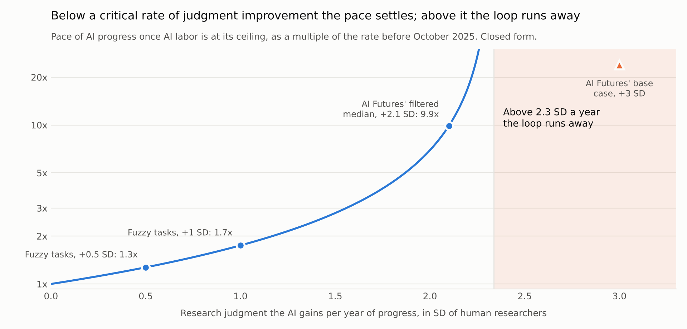
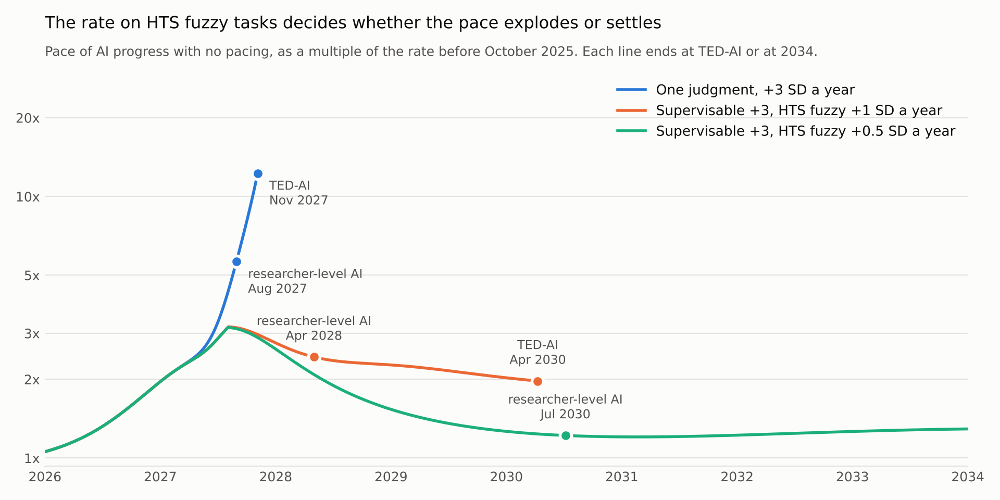

# A simple model of pacing and the takeoff of automated AI R&D

Draft of 2026-11-13, revised the same day against the full model's sampled results. The runnable model is `simple_model.py`: one file, one state variable, numpy only. The two full models and their evidence are in [README.md](README.md).

## The question

AI now does a growing share of AI research. If better AI makes research faster and faster research makes better AI, the pace can compound. Three kinds of policy are proposed to hold it down: comprehension audits, which let a lab deploy only what its people understand; an internal-use lag, which makes a lab work with the AI it had some months ago; and limits on research compute. This model asks what each does to the dates of two milestones:

- **Researcher-level AI:** an all-AI lab has the research judgment of the best human researcher.
- **TED-AI:** an all-AI lab is far past every human expert. The level is AI Futures' definition.

## Five ideas

**1. The loop, with research getting harder.** Progress is measured in years of progress at the rate before October 2025, and pace is years of progress per calendar year. Each year of software progress ahead of the historical schedule halves what a unit of research input buys.

```
software pace = research input / 2 ^ (years of software progress ahead of schedule)
pace          = 2/3 * software pace + 1/3
```

The last third of progress comes from more compute, which AI research does not speed up here.

**2. AI labor helps up to a ceiling.** AI labor per researcher doubles every 0.25 years of progress. Research input rises with its square root and tops out at 15 times, because experiments need compute.

**3. Judgment has no ceiling, and it comes in two kinds.** Research input is multiplied by the lab's research judgment: which experiments to run and what to make of them. AI judgment starts far below people's and improves with progress.

- **Supervisable tasks** are ones whose output people can judge, because the task has clear criteria or because people judge it reliably anyway. Human feedback trains the AI on them. AI judgment on them improves 3 SD of the human researcher distribution per year of progress.
- **Hard-to-supervise (HTS) fuzzy tasks** have no clear criteria, and human judgment on them is systematically flawed, so there is little to train on. Deciding what to work on next is one. AI judgment on them improves 1 SD or 0.5 SD.
- **Supervisable work stands in for HTS fuzzy work poorly.** However good the AI gets at supervisable tasks, the lab's judgment is at most 4 times its judgment on HTS fuzzy tasks.
- **Some work needs a person.** On real tasks today, 14% need a person however short the task. That share falls as AI judgment on HTS fuzzy tasks rises.

**4. Understanding takes people's time.** Deployed changes grow with AI labor: 1% more labor, 0.4% more changes. The hours a person needs to understand one do not shrink. Understanding everything deployed takes 14% of researchers' time today. Time spent understanding is time not spent directing AI labor.

**5. The lab chooses.** Under audits a lab may deploy only what its people understand. It splits researcher time between research and understanding to go fastest, and understands the most valuable changes first.

## The result that needs no simulation

Once AI labor is at its ceiling, the only thing still compounding is judgment. Research halves in productivity for each year ahead of schedule, so judgment must double research input once per year of progress to keep the pace rising. That gives a critical rate:

```
critical rate = ln 2 / (value of one SD of judgment * software share of progress) = 2.3 SD per year of progress
```

- **Above the critical rate the loop runs away.** At 3 SD a year the pace passes 12 times within a year.
- **Below it the pace settles.** It settles at 1.7 times the historical rate when the binding judgment improves 1 SD a year, and 1.3 times at 0.5 SD.
- **The binding judgment is the HTS fuzzy one.** Because supervisable work stands in for HTS fuzzy work poorly, the rate on HTS fuzzy tasks sets where the pace settles, however fast supervisable judgment improves.



So whether there is an explosion at all turns on how fast AI judgment improves on the tasks that are hardest to supervise. Nothing measures that rate. Benchmarks that score a model against people's judgment show judgment on supervisable tasks rising with general capability, and they stop at people's level.



The simulated paths show the same split. The dip in mid-2027 in the two lower lines is where the work that needs a person starts to hold AI labor down.

## What pacing does

Dates with no pacing, and the delay each policy adds, from `results/tables_simple.md`:

| | One judgment, +3 SD | Supervisable +3, HTS fuzzy +1 SD | Supervisable +3, HTS fuzzy +0.5 SD |
|---|---|---|---|
| Researcher-level AI, no pacing | Aug 2027 | Apr 2028 | Jul 2030 |
| TED-AI, no pacing | Nov 2027 | Apr 2030 | Oct 2037 |
| Central audits delay TED-AI | +1 mo | +10 mo | +15 mo |
| Strict audits delay TED-AI | +3 mo | +13 mo | +18 mo |
| 3-month lag delays TED-AI | +6 mo | +3 mo | +1 mo |
| 9-month lag delays TED-AI | +12 mo | +9 mo | +3 mo |
| 3-fold compute cut delays TED-AI | +4 mo | +6 mo | +6 mo |

- **The rate on HTS fuzzy tasks decides the dates.** Halving it moves TED-AI by more than seven years. Lowering the supervisable rate from 3 to 2.1 SD moves it by three months.
- **Audits barely move researcher-level AI.** They delay it by a month or two in each of these cases. The gate starts to bind only about when that level arrives.
- **Where judgment improves fast, audits buy a month.** The loop runs away on judgment, and people's time to understand what is deployed stops mattering within months.
- **Where HTS fuzzy judgment is slow, audits buy 10 to 15 months here.** The next section compares that with the full models.
- **How fast deployed changes grow with AI labor decides the audit result.** At 0.2% more changes per 1% more labor, central audits delay TED-AI by 2 months in the middle case. At 0.6% they delay it by 20. Nobody has measured this number.
- **Work that needs a person and audits act on the same margin.** Without the 14% of work that needs a person, central audits would delay TED-AI by 21 months in the middle case, against 10 with it. Where the work itself keeps people in the loop, audits add less.

## How it compares with the full models

The comparison is with the full model's medians over 96 sampled trajectories, with the same 14% of work needing a person.

| | One judgment, +3 SD | Supervisable +3, HTS fuzzy +1 SD | Supervisable +3, HTS fuzzy +0.5 SD |
|---|---|---|---|
| Researcher-level AI, no pacing: simple | Aug 2027 | Jul 2028 | Nov 2030 |
| Researcher-level AI, no pacing: full | Jul 2027 | May 2028 | Oct 2030 |
| TED-AI, no pacing: simple | Nov 2027 | May 2030 | Oct 2037 |
| TED-AI, no pacing: full | Oct 2027 | Jul 2029 | after 2039 |
| Central audits delay TED-AI: simple | +1 mo | +7 mo | +11 mo |
| Central audits delay TED-AI: full | +1 mo | +2 mo | +3 mo |
| 9-month lag delays TED-AI: simple | +12 mo | +10 mo | +3 mo |
| 9-month lag delays TED-AI: full | +11 mo | +13 mo | +10 mo |
| 3-fold compute cut delays TED-AI: simple | +4 mo | +6 mo | +6 mo |
| 3-fold compute cut delays TED-AI: full | +5 mo | +10 mo | +13 mo |

Where the two agree:

- **Dates with no pacing.** Researcher-level AI is within two months in every case, and TED-AI within ten months where the full model's median falls before 2040.
- **The HTS fuzzy rate matters far more than the supervisable rate.**
- **Audits move researcher-level AI by a month or less.**
- **With judgment improving fast on every task, audits buy a month and a lag buys its length or more.**
- **Work that needs a person changes nothing when judgment is fast, delays the milestones when HTS fuzzy judgment is slow, and cuts what audits add.**

Where they differ, the full model is the one to cite:

- **The simple model overstates audits where HTS fuzzy judgment is slow, by about three times.** It has 7 to 11 months, against a sampled median of 2 to 3. The full model's upper quartile is 4 to 7 months, and its one example trajectory gives 4 and 25. Two things explain part of the gap. In the full model a lab with no audit keeps understanding most of what it deploys for as long as its people's judgment is worth having, so an audit asks for less that is new. And the simple model is one trajectory, which in the middle case is slower than the full model's median.
- **The simple model understates a lag where HTS fuzzy judgment is slow.** Below the critical rate its loop makes up most of a setback. The full model's sampled trajectories lose about the lag's length. With HTS fuzzy tasks at +0.5 SD those are the faster half of trajectories, the ones that reach TED-AI before 2040.
- **So the simple model does not settle which of audits and a lag buys more time in a slow takeoff.** It ranks audits first with HTS fuzzy tasks at +0.5 SD. The full model ranks a 9-month lag first in every case.

## Inputs

| Input | Value | Basis |
|---|---|---|
| Pace on May 1 and Nov 1, 2026 | 1.2 and 1.7 times | METR's November 2026 estimate as AI Futures reads it. The two labor inputs are fitted to these |
| Software share of progress | 2/3 | Greenblatt, via Cotra |
| Labor's exponent in research | 0.5 | Cotra |
| Ceiling on labor's effect | 15 times | AI Futures Model default. 60 in its November example |
| Halvings of research productivity per year ahead | 1 | AI Futures: research inputs grew twofold a year |
| AI judgment on Nov 1, 2026 | -3.5 SD | AI Futures' base case |
| Value of one SD of judgment | 0.445 in logs | AI Futures Model's distribution of research taste: one SD is worth about 1.55 times |
| Rate on supervisable tasks | +3 SD | AI Futures' base case |
| Rate on HTS fuzzy tasks | +1 and +0.5 SD | Judgment. No measurement |
| Weight of supervisable work | 65% | Three anchors, none a measurement of it. See the full briefing |
| Substitution between supervisable and HTS fuzzy work | 0.25 | Judgment |
| Work that needs a person | 14% | OpenAI, tasks under 15 minutes, January to July 2026 |
| A person's time on that work | 0.5% of doing it | The PI's estimate: half an hour a day for each running session, with a session doing 8 to 12 person-days of work in a day |
| Time understanding deployed changes today | 14% | Assumption in the full model, from counts and hours per change |
| Growth of deployed changes with AI labor | 0.4 | Assumption. Not measured |
| Pareto index of a change's value | 1.8 | Read from one developer's description of compute multipliers |

The fit puts AI labor per researcher at 12 times on Nov 1, 2026. Anthropic staff self-report 12 times and Cotra estimates about 10.

## What it leaves out

- **Sampling.** One set of central values. The full model samples AI Futures' distribution.
- **The link from comprehension to judgment.** In the full model people apply judgment only to changes they understand. It moves dates by days to weeks there, and it lowers what audits add.
- **Sign-off without a comprehension standard.** It does little in the full model.
- **Training compute after a cut.** A compute cut here lowers experiment compute once and leaves the compute third of progress alone.
- **Safety research.** The model has one clock, for capabilities. The source of the HTS fuzzy definition argues that fuzzy tasks are more common in safety research than in capabilities research, which would make it the slower of two clocks.

## Run it

```bash
pip install numpy
```

```bash
python simple_model.py
```

```bash
python -m pytest test_simple_model.py
```

The figures need matplotlib:

```bash
python simple_figures.py
```
