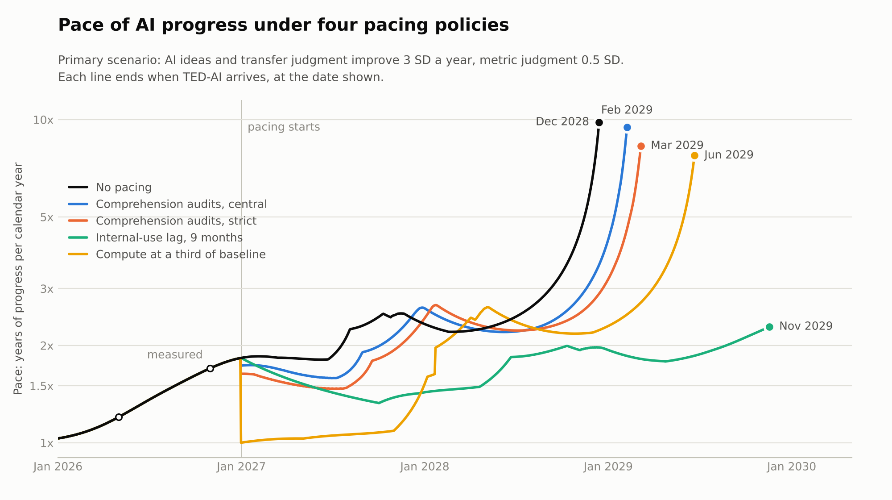

# The chain model: from small experiments to real value

Draft of 2026-11-16, from Readback Labs. This folder is self-contained: one model file, its checks, its results and this write-up. It needs Python with numpy. Every number in the tables below is from `results/tables.md`, which the script writes.

## The question

AI now does a growing share of AI research. If better AI makes research faster and faster research makes better AI, the pace can compound. This model asks when that happens and what three pacing policies do to the date.

It is built for one disagreement. One side holds that AI research is mostly hill-climbing on measurable targets, so AI will soon do it all. The other holds that the hard part is deciding what to climb: defining a metric that means what you want, noticing when a result games it, and telling which small-scale results will hold at scale. The model gives each of those its own place, so that the disagreement becomes a question about a few inputs.

Terms used below:

- **Progress** is measured in years of AI progress at the rate before October 2025. **Pace** is years of progress per calendar year.
- **SD** is a standard deviation of research judgment across a lab's researchers. The best researcher is at +3.09 SD.
- **Researcher-level AI** is the date an AI-only lab's research matches a lab made up of its best researchers. **TED-AI** is the date it matches the level the AI Futures Project uses for top-expert-dominating AI, +7.72 SD. "Where the two levels come from" below gives their source.
- **Comprehension audits** let a lab deploy only the changes its own people understand. An **internal-use lag** makes a lab work with the AI it had some months ago. A **compute limit** holds a lab to a share of the compute it would otherwise use for research and for training.

## The chain

Experiments at scale are limited by compute. Behind each one the lab runs many small experiments and backs the candidate that looks best. Two links separate how good a candidate looks from what it is worth.

```
small-scale result  ->  result on the metric at scale  ->  real value
                 transfer                            validity
```

1. **Throughput.** AI labor raises the number of experiments a lab gets from its compute, with diminishing returns and a ceiling.
2. **Candidates.** AI labor multiplies the small experiments behind each experiment at scale. The best of n candidates is about sqrt(2 ln n) SD better than a typical one, so volume helps less and less. AI also proposes better candidates as its judgment on well-defined problems improves.
3. **Transfer** is the share of a small-scale gain that holds at scale. It depends on who judged which candidate would transfer.
4. **Validity** is the share of a gain on the metric that is real. It depends on who defined the metric and checked the result for gaming.
5. **People's time.** A person who judges an experiment supplies both links. Researchers judge as many experiments as they have time for, and the AI judges the rest with its own transfer and metric judgment. AI takes over implementation, which frees researcher time. Managing the agents takes part of it back, and more experiments use up the rest.
6. **What people can vouch for.** People's judgment applies to gains up to what their best researcher could have proposed. The AI judges any gain beyond that.
7. **The lab chooses.** It runs the amount of AI labor that gives it the most research. More agents mean more experiments and more candidates. They also mean more for people to judge and, under audits, more deployed changes to understand.
8. **The loop.** Real research makes software progress, and progress makes better AI.
9. **Difficulty.** Research gets harder as software advances: each year of software progress halves what a unit of research buys. A lab's other inputs, compute and people, have grown fast enough to offset that, which is what a pace of 1 means. Whether the loop runs away or peters out turns on whether the AI's judgment adds research faster than difficulty takes it away.

The links multiply in the exponent of an experiment's value:

```
value = exp(kept * (standing + gain) - standing)
kept  = transfer * validity, each against people's
```

`gain` is what has been added at small scale since October 2025: better ideas from the AI, and the best of more candidates. `standing` is what an experiment was already worth. An experiment people judged keeps all of its gain. One left to an AI with weak transfer and metric judgment keeps part.

Three kinds of AI judgment improve at their own rates, in SD per year of progress:

| Kind | What it does | Rate |
|---|---|---|
| Ideas | Proposes candidates on a well-defined problem. No ceiling | +3 SD |
| Transfer | Judges which small-scale gains hold at scale | +3, +1 or +0.5 SD |
| Metrics | Defines the next metric and debugs results that game the current one | +3, +1 or +0.5 SD |

All three start at -3.5 SD on November 1, 2026 and improve with progress, so a lab that goes faster gets better judgment sooner.

## What it builds on

The outer structure is the AI Futures Project's model: experiments limited by compute, AI labor with diminishing returns, judgment in SD of the researcher distribution, and research that gets harder. With the AI's two links set to people's values and no gain from selection, research here is the AI Futures rule exactly: experiments times the average value of candidates when each researcher uses the better of their own judgment and the AI's. A check confirms this.

An experiment left to the AI of November 2026 is worth 21% of one a person judged. That is the value the AI Futures taste distribution gives judgment at -3.5 SD, and `standing` is set to match it.

## Calibration

Three inputs are fitted to three measurements, all from Anthropic.

| Measurement | Value | Source | Input fitted | Fitted value |
|---|---|---|---|---|
| Pace on May 1, 2026 | 1.2 times | The AI Futures Project's estimate in its update of November 10, 2026 | Years of progress per doubling of AI labor | 0.11 |
| Pace on Nov 1, 2026 | 1.7 times | The same update's reading of METR's assessment of November 5, 2026, which put the pace at Anthropic at about 2 times with a range of 1.3 to 3 and attributed 80% of the rise to AI | Growth of judging time with candidates | 0.19 |
| AI labor per researcher in late August 2026 | 19 agent hours for each human work-hour | Anthropic, "How employment is changing at Anthropic", Figure 2, research organizations | AI labor on Oct 1, 2025 | 0.03 |

- **The fitted doubling matches Anthropic's series, which was not used to fit it.** The model's AI labor doubles about every month in mid-2026. Anthropic's series for its research organizations rose from 0.2 agent hours per human hour in February 2026 to 19 in late August, a doubling every 31 days. The model's path is up to 40% below the series in between. The series was read from the chart by eye.
- **OpenAI's figure is much lower.** It reported 3.15 agent workdays per researcher workday in mid-August 2026. An earlier draft of this model was fitted to that trend. The measures differ: Anthropic counts agent runtime, with subagents pooled, against a 40-hour week.
- **People's time is already short.** In the fitted model researchers judge 36% of experiments at scale in late August 2026, 17% on November 1 and 9% on January 1, 2027.
- **Managing agents takes researcher time.** Anthropic reports that 22% of model researchers' agent sessions in spring 2026 were meta-work: writing specs for agents, setting one agent to review another, watching pipelines. The model takes that share of researcher time out of what implementation frees. The figure is a share of sessions, and using it as a share of time is an assumption.
- **The model extrapolates the doubling.** It has 113 agent hours per human hour on November 1, 2026 and 724 on January 1, 2027. What AI labor adds to experiments and to candidates is capped, and from 2027 a lab runs only as much of it as gives the most research.

## Results with no pacing

The primary scenario is the third row: the AI's ideas and its transfer judgment improve 3 SD a year, and its metric judgment 0.5 SD.

| AI judgment gained per year of progress | Researcher-level AI | TED-AI |
|---|---|---|
| Ideas, transfer and metrics all +3 SD | May 2027 | May 2027 |
| Ideas and transfer +3, metrics +1 | Dec 2027 | Jan 2028 |
| **Ideas and transfer +3, metrics +0.5 (primary)** | **Aug 2028** | **Dec 2028** |
| Ideas +3, transfer and metrics +1 | May 2028 | May 2028 |
| Ideas +3, transfer +1, metrics +0.5 | Jan 2029 | Apr 2029 |
| Ideas +3, transfer and metrics +0.5 | Sep 2029 | Jan 2030 |

- **Slow transfer and metric judgment delay the takeoff by up to three years.** TED-AI arrives in May 2027 if all three kinds of judgment improve 3 SD a year, and in January 2030 if transfer and metric judgment both improve 0.5 SD a year.
- **They do not prevent it.** In the primary scenario the pace holds between 1.8 and 2.5 times through mid-2028 and rises steeply in the months after.
- **A weak link costs a share of the slope and sets no ceiling.** An AI that keeps 10% of a gain turns ideas improving 3 SD a year into 0.3 SD a year of real judgment. The loop runs away once the AI keeps 78% of what people keep.
- **People judge very little of the work.** In the primary scenario researchers judge 9% of experiments at scale in January 2027 and 4% from mid-2027.
- **Measured progress runs ahead of real progress.** The pace on the lab's metrics is 4.6 times in July 2027 against a real 1.9, and 5.4 against 2.5 in July 2028.
- **TED-AI arrives on the strength of ideas.** When an AI-only lab's research reaches the TED-AI level in December 2028, the AI's metric judgment is at -0.9 SD. Its ideas are 12 SD above the median researcher's and it keeps 64% of their gain.
- **The lab has two ways of working and moves between them.** It can run every agent it has and leave most experiments to the AI, or run a few dozen agents per researcher and have people judge a third of the experiments. Around January 2028, when the AI's ideas are just past what people can vouch for, the second gives 5% more research and the lab takes it.

The path in the primary scenario:

| Date | Pace | Pace as measured | Experiments at scale | Share of experiments people judge | Share of a gain the AI keeps | AI ideas and transfer judgment | AI metric judgment |
|---|---|---|---|---|---|---|---|
| Jan 2027 | 1.8x | 2.5x | 10.1x | 9% | 3% | -2.6 SD | -3.3 SD |
| Jul 2027 | 1.9x | 4.6x | 15.3x | 4% | 11% | +0.1 SD | -2.9 SD |
| Jan 2028 | 2.3x | 1.7x | 4.0x | 32% | 21% | +3.6 SD | -2.3 SD |
| Jul 2028 | 2.5x | 5.4x | 15.8x | 4% | 32% | +7.1 SD | -1.7 SD |

## What pacing does



The figure is the primary scenario. Each line is the pace under one policy and ends when TED-AI arrives. `figure.py` draws it.

Delay to TED-AI in every scenario. Pacing starts January 1, 2027.

| AI judgment gained per year of progress | Central audits | Strict audits | 9-month lag | Compute at a third of baseline |
|---|---|---|---|---|
| Ideas, transfer and metrics all +3 SD | +0 mo | +1 mo | +11 mo | +4 mo |
| Ideas and transfer +3, metrics +1 | +2 mo | +3 mo | +10 mo | +6 mo |
| **Ideas and transfer +3, metrics +0.5 (primary)** | **+2 mo** | **+3 mo** | **+11 mo** | **+6 mo** |
| Ideas +3, transfer and metrics +1 | +2 mo | +3 mo | +9 mo | +7 mo |
| Ideas +3, transfer +1, metrics +0.5 | +2 mo | +4 mo | +11 mo | +7 mo |
| Ideas +3, transfer and metrics +0.5 | +2 mo | +4 mo | +10 mo | +7 mo |

Central audits take the hours to understand every deployed change that researchers are assumed to spend today, 14% of their time. Strict audits take twice the hours. The compute limit holds a lab to a third of the compute it would otherwise use for experiments at scale, for small experiments, for running AI labor and for training the next model.

- **A 9-month lag delays TED-AI the most, by 9 to 11 months in every scenario.**
- **A compute limit at a third of baseline delays it by 4 to 7 months.** Training waits about a year for its allowance to catch up with what it has already used, and research runs on a third of the compute from then on.
- **Audits delay it by up to 2 months at the central standard and 1 to 4 at the strict one.**
- **An audited lab runs far fewer agents.** More agents mean more changes to understand, so the lab cuts the AI labor it runs to between tens and thousands of agents per researcher, where it could run a hundred thousand or more. It loses little, because what agents add to experiments and to candidates flattens, and with fewer experiments people judge more of them.
- **So in this model audits work as a brake on how much AI labor a lab runs.** They slow the pace through 2027 and delay the takeoff by months.
- **An earlier version of this section had audits delaying TED-AI by one to four years.** There the lab had to run all the AI labor it had, and the pace under audits fell below its level before AI. That result is withdrawn.
- **The audit result still rests on deployed changes growing with AI labor.** The model assumes 0.4% more changes for each 1% more labor. Anthropic's figures support that over the range seen so far: commits per engineer rose 5 times in six months while agent hours per person rose 50 to 100 times, an elasticity of about 0.35 to 0.4. If deployed changes do not grow with AI labor, audits delay TED-AI by nothing.
- **Half of audit time is taken to count as judging.** At none of it the central delay in the primary scenario is 3 months, and at all of it 1.
- **A third is a tight compute limit.** In the AI Futures Project's input series, experiments, training and running AI researchers take 62% of the leading company's compute in 2026: 50%, 7% and 5%. A third of that is 21%, which matches a rule that about 79% of compute go to other uses. A rule of 60% would leave research about two thirds of baseline and delay TED-AI by 2 to 3 months. That run is not in the results file.

## Where the two levels come from

Both levels are the AI Futures Project's, read from its public code.

- **Its definitions.** A superhuman AI researcher "can fully automate AI R&D". A TED-AI "is at least as good as top human experts at virtually all cognitive tasks".
- **How its model marks them.** Both are levels of one quantity, AI research taste, in SD of the researcher distribution. The superhuman AI researcher is at the top researcher's level, which the model takes as the 99.9th percentile of a normal distribution, +3.09 SD (`TOP_RESEARCHER_SD` in the code's `progress_model/config.py`). TED-AI is a number of median-to-top gaps further on, each 3.09 SD (`ted_ai_m2b`, used in `progress_model/_impl.py`).
- **The +7.72 SD.** The number of gaps is a forecaster's judgment. It is 1.50 in the parameters of the example trajectory in the project's update of November 10, 2026, which gives 3.09 times 2.50, or +7.72 SD. The default in the public code is 1.00, which gives +6.18 SD.
- **What this model does with them.** It applies both levels to the research an AI-only lab gets from an experiment, after transfer and validity. It does not test "virtually all cognitive tasks". `chain_model.py` computes both levels from the percentile and the number of gaps, in the constants at the top of the file.

## How fast research gets harder

The debate over whether automated research runs away or peters out is a debate about this input. The model's value is 1: each year of software progress halves what research buys. The three fitted inputs are refitted at each value below.

| Halvings of what research buys per year of software progress | Share of a gain the AI must keep for the loop to run away | TED-AI, all judgment +3 SD | TED-AI, primary scenario | Central audits delay it |
|---|---|---|---|---|
| 0.5 | 39% | Apr 2027 | Apr 2028 | +1 mo |
| 1 | 78% | May 2027 | Dec 2028 | +2 mo |
| 1.5 | 117% | Jun 2027 | Jun 2029 | +2 mo |
| 2 | 156% | Aug 2027 | Nov 2029 | +2 mo |

The table stops at 2 because the model cannot reach the pace measured in November 2026 at much higher values. The highest difficulty that still fits, and how it moves with the inputs it rests on:

| Inputs | Highest difficulty that fits the pace of Nov 2026 | Share of a gain the AI must keep for the loop to run away at that difficulty |
|---|---|---|
| Central | 2.08 | 162% |
| AI labor per researcher in late August 2026: 38, twice Anthropic's figure | 2.63 | 205% |
| AI labor per researcher in late August 2026: 9.5, half of it | 1.36 | 106% |
| AI labor per researcher in late August 2026: 3.8, OpenAI's trend | none above 0.3 | |
| No researcher time goes to managing agents | 2.47 | 192% |
| 25% of researcher time was on judging in Oct 2025 | 2.69 | 210% |
| 60% of researcher time was on judging in Oct 2025 | 0.38 | 30% |
| Experiments rise with AI labor to the power 0.4 | 1.75 | 136% |
| Experiments rise with AI labor to the power 0.6 | 2.29 | 178% |
| Experiments from unlimited AI labor: 60 times | 2.52 | 196% |

- **The pace of 2026 caps how hard research can be getting, and the cap is loose.** At the central inputs the model reaches 1.7 times in November 2026 at any difficulty up to 2.08.
- **The measured pace does not show that the loop will run away.** The most the AI can keep of a gain here is 153% of what people keep. Above a difficulty of about 1.96 the loop needs more than that, so it cannot run away on ideas alone, and the pace of 2026 fits difficulties on both sides of that line.
- **The cap moves with the AI labor figure.** It is 2.08 with Anthropic's 19 agent hours per human hour, 1.36 at half that, and below 0.3 with OpenAI's 3.8 for the same date. An earlier draft fitted to OpenAI's trend put the cap at 1.02.
- **It moves as far with how researchers spent their time.** It is 2.69 if a quarter of researcher time went to judging in 2025 and 0.38 if 60% did.
- **The cap takes the 1.7 times as the AI's doing.** METR attributed 80% of the rise in pace to AI and called the estimate uncertain. Garicano and Imas (November 2026) read the same period as faster growth in spending with diminishing returns and a one-time gain from AI tools.
- **TED-AI arrives at every difficulty in the table.** At 2 the loop cannot run away on ideas alone, and TED-AI still comes in November 2029 in the primary scenario, because ideas have no ceiling and the pace holds above 1 while they accumulate.
- **Easier research brings the takeoff forward by months.** At 0.5, TED-AI in the primary scenario comes in April 2028 against December 2028.
- **One outside estimate is of the same order.** Garicano and Imas fit a research production function to Anthropic's capability index against its R&D spending. Their estimates have progress per unit of input falling about 0.8% to 6% for each index point. At about 13 index points for a year of progress before October 2025, that is 0.15 to 1.2 halvings a year. The conversion is ours, and their measure covers all progress and all R&D spending, so the comparison is rough.

## Each input moved

The primary scenario. TED-AI is December 2028 in the central row. Across the 20 rows in `results/tables.md` it runs from December 2027 to July 2029.

- **Earliest.** Validity of 0.3 with the AI judging today (December 2027). An experiment ceiling of 60 times (March 2028). People able to vouch for any gain (April 2028).
- **Latest.** Validity of 0.01 with the AI judging today (July 2029). An AI that never judges better than people, and ideas at +2.1 SD (both June 2029).
- **Time spent managing agents matters little.** With none, TED-AI comes in November 2028, and with a third of researcher time, January 2029.
- **The delay from central audits is 1 to 4 months in every row** but the one where deployed changes do not grow with AI labor. The delay from a 9-month lag is 10 to 15 months.
- **The level set for TED-AI matters little.** At the public code's default of +6.18 SD, TED-AI comes in November 2028, a month earlier. That run is not in the results file.

## Inputs

| Input | Value | Basis |
|---|---|---|
| Software share of progress | 2/3 | Judgment. The rest is more compute |
| Difficulty: halvings of what research buys per year of software progress | 1 | Judgment. The pace of 2026 allows up to 2.08 at the central inputs. Tested at 0.5, 1.5 and 2 |
| Experiments from AI labor | Square root, ceiling of 15 times | Judgment. Tested at 5 and 60 |
| Small experiments behind each one at scale, Oct 2025 | 20 | Judgment, from researchers' accounts that most experiments are discarded |
| Most candidates small-scale compute allows | 10,000 | Judgment. Tested at a million |
| Value of one SD of small-scale result | 0.3 log units | Judgment. Tested at 0.6 |
| Value of one SD of researcher judgment | 0.445 log units | The AI Futures Model's gap between the median and the top researcher, a factor of 3.97 over 3.09 SD |
| AI judgment on Nov 1, 2026 | -3.5 SD, all three kinds | The AI Futures Project's base case |
| Rate of ideas | +3 SD per year of progress | The AI Futures Project's base case. Tested at +2.1 |
| Rates of transfer and metric judgment | +3, +1 and +0.5 SD | +1 is the low end of the AI Futures Project's 80% interval and +0.5 is half of it. Neither is a measurement |
| Transfer: people, AI today, ceiling | 0.7, 0.2, 0.9 | Judgment. Only the ratios enter. AI today tested at 0.4 |
| Validity: people, AI today, ceiling | 0.8, 0.05, 0.95 | Judgment. Only the ratios enter. AI today tested at 0.3 and 0.01 |
| Shape of a link between the AI today and people's level | The same ratio for each SD | As research value is in the AI Futures Model |
| People can vouch for gains up to | +3.09 SD ideas | Judgment: the best researcher. Tested at +1 SD and with no limit |
| Researcher time managing agents once AI does the implementation | 22% | Anthropic: the share of model researchers' agent sessions that were meta-work in spring 2026, used as a share of time. Safety researchers were at 25%. Tested at 0 and a third |
| Researcher time on results, metrics and plans, Oct 2025 | 40% | Judgment. One of eight researchers Epoch AI interviewed said "60% of my time would be automated". Tested at 60% |
| Time to understand all deployed changes today | 14% | Judgment |
| Growth of deployed changes with AI labor | 0.4 | Judgment. Anthropic's commits per engineer and agent hours give about 0.35 to 0.4 over six months of 2026. Tested at 0 |
| Spread of value across deployed changes | Pareto index 1.8 | Judgment |
| Share of audit time that counts as judging | 50% | Judgment. Tested at 0 and 100% |

## What to hold loosely

- **AI labor keeps doubling, with no cap.** The model extrapolates a monthly doubling of agent hours per researcher that has been observed for seven months, and Anthropic's own series flattens in its last ten days. Readback's judgment is that the ratio keeps climbing as AI takes over research. What the labor adds is capped, and a lab runs only as much of it as helps.
- **Judgment improves with progress, with no limit on how fast.** A lab would need its feedback on transfer and metrics to keep up.
- **Ideas have no ceiling.** AI judgment on well-defined problems rises without limit, as in the AI Futures Model.
- **Research is one stream.** Pretraining and post-training are not separated. A model in which gains on a fixed metric run out and progress waits for the next valid target would need two.
- **Validity does not fall under pressure.** Selecting harder on a metric does not lower its validity here.
- **The lab sees validity.** It is taken to know what its gains are really worth.
- **One set of central values.** Nothing is sampled.

## Run it

```
pip install -r requirements.txt
python chain_model.py > results/tables.md
python figure.py
pytest
```

`calibrate()` in `chain_model.py` refits the three fitted inputs. It takes about two minutes.

| File | What it is |
|---|---|
| `chain_model.py` | The model and the code that writes the tables |
| `figure.py` | Draws `results/pace.png`. Needs matplotlib |
| `test_chain_model.py` | Sixteen checks: the calibration, the AI Futures case the model reduces to, and the directions its results must move in |
| `results/tables.md` | Every table, written by the script |
| `LICENSE` | MIT |

This model is a companion to Readback's pacing briefing, which sits one folder up in the repository it comes from. Nothing here depends on it.
